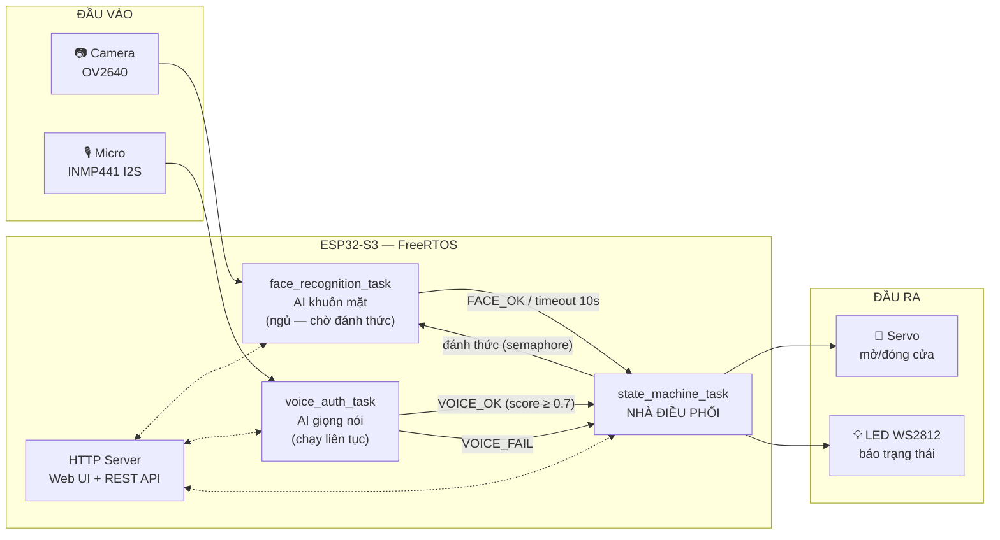
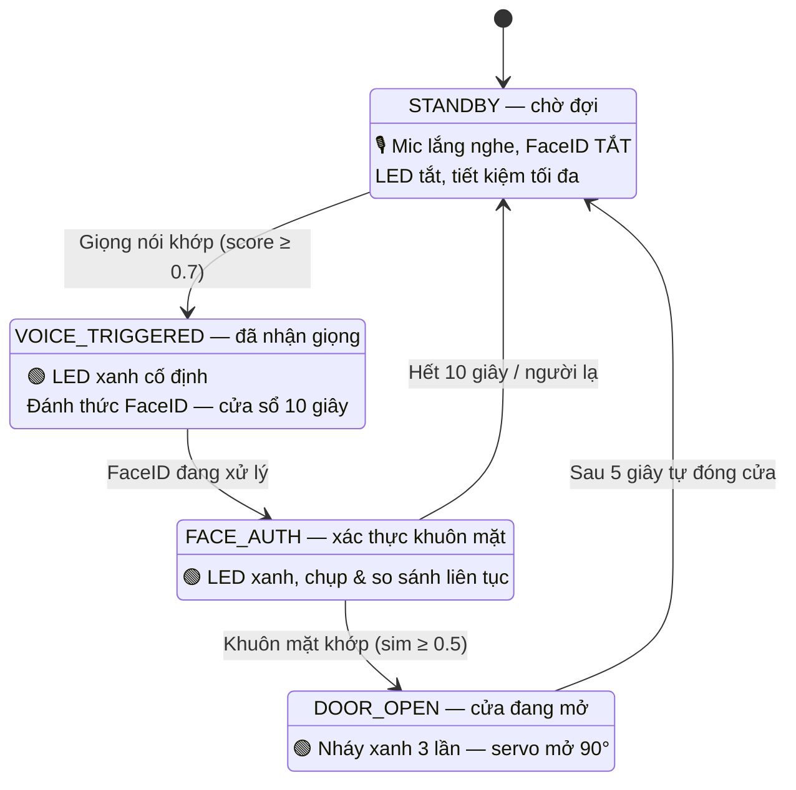
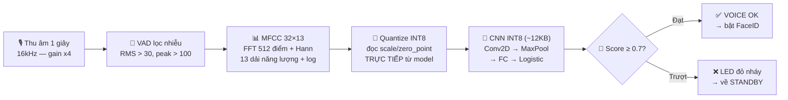
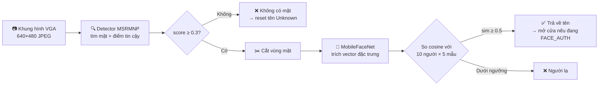

# BÁO CÁO DỰ ÁN
# 🔐 EDGE AI — KHÓA CỬA THÔNG MINH XÁC THỰC HAI LỚP (GIỌNG NÓI + KHUÔN MẶT)

---

## MỤC LỤC

1. Giới thiệu tổng quan
2. Mục tiêu và ý tưởng của dự án
3. Vì sao chọn Edge AI (AI trên thiết bị)?
4. Phần cứng sử dụng
5. Kiến trúc phần mềm tổng thể
6. Máy trạng thái — trái tim của hệ thống
7. Trí tuệ nhân tạo lớp 1: Nhận dạng giọng nói
8. Trí tuệ nhân tạo lớp 2: Nhận dạng khuôn mặt
9. Giao diện web và hệ thống API
10. Hệ thống lưu trữ dữ liệu
11. Điều khiển phần cứng: servo cửa và đèn báo
12. Quy trình huấn luyện lại mô hình giọng nói
13. Quá trình biên dịch và triển khai
14. Phân tích bảo mật
15. Hiệu năng và tài nguyên sử dụng
16. Hạn chế hiện tại và hướng phát triển
17. Kết luận

---

## 1. GIỚI THIỆU TỔNG QUAN

Dự án xây dựng một **hệ thống khóa cửa thông minh** hoàn chỉnh, trong đó toàn bộ trí tuệ nhân tạo (nhận dạng giọng nói chủ nhà và nhận dạng khuôn mặt) đều chạy **ngay trên vi điều khiển**, không cần kết nối Internet hay máy chủ bên ngoài.

Hệ thống yêu cầu người dùng vượt qua **hai lớp xác thực liên tiếp**: trước hết phải nói một câu để hệ thống nhận ra giọng nói, sau đó nhìn vào camera để hệ thống nhận ra khuôn mặt. Chỉ khi **cả hai lớp đều được xác nhận** trong cùng một phiên, cửa mới tự động mở. Đây là điểm khác biệt cốt lõi so với các khóa cửa thông thường vốn chỉ dùng một phương thức xác thực duy nhất.

Toàn bộ hệ thống vận hành trên một con chip duy nhất — ESP32-S3 — với các thiết bị ngoại vi đi kèm: camera, micro, động cơ servo (đóng/mở cửa) và đèn LED RGB (báo trạng thái). Ngoài ra, chip còn chạy một **máy chủ web nhúng** cho phép chủ nhà đăng ký khuôn mặt, đăng ký giọng nói, xem camera trực tiếp và tinh chỉnh ngưỡng nhạy cảm ngay từ trình duyệt điện thoại hoặc máy tính.

**Thông tin kỹ thuật chính:**

| Hạng mục | Giá trị |
|---|---|
| Vi điều khiển | ESP32-S3 (2 nhân Xtensa LX7, 240 MHz) |
| Bộ nhớ flash | 8 MB |
| RAM ngoài (PSRAM) | 8 MB, chuẩn Octal, 80 MHz |
| Mô hình giọng nói | Mạng CNN, khoảng 13.600 tham số, nén INT8 (~12 KB) |
| Mô hình khuôn mặt | MobileFaceNet pre-trained của Espressif (ESP-DL) |
| Số người tối đa | 10 khuôn mặt, mỗi người 5 mẫu |
| Kết nối | Wi-Fi chuẩn STA, máy chủ web tại cổng 80 |

---

## 2. MỤC TIÊU VÀ Ý TƯỞNG CỦA DỰ ÁN

### 2.1. Bài toán đặt ra

Các hệ thống khóa cửa thông minh trên thị trường thường gặp ba vấn đề:

**Thứ nhất**, khóa vân tay hay thẻ từ chỉ xác thực một yếu tố duy nhất. Nếu kẻ gian sao chép được dấu vân tay (dấu vân tay rất dễ bị lấy từ bề mặt đồ vật) hoặc ăn cắp thẻ, cửa sẽ mở ngay.

**Thứ hai**, nhiều giải pháp smart lock gửi hình ảnh/âm thanh lên đám mây để xử lý. Điều này tạo ra hai rủi ro: quyền riêng tư (hình ảnh chủ nhà nằm trên máy chủ của bên thứ ba) và tính sẵn sàng (mất mạng là mất chức năng).

**Thứ ba**, các giải pháp nhận dạng khuôn mặt giá rẻ dễ bị đánh lừa bằng một tấm ảnh in giấy.

### 2.2. Giải pháp của dự án

Dự án trả lời từng vấn đề trên như sau:

- **Xác thực hai lớp độc lập về phương thức sinh trắc**: giọng nói (đặc trưng của thanh quản) và khuôn mặt (đặc trưng hình học gương mặt). Kẻ gian phải vượt qua cả hai cùng lúc — điều khó hơn nhiều so với giả mạo một yếu tố.
- **100% xử lý tại chỗ (Edge AI)**: hình ảnh và âm thanh không bao giờ rời khỏi thiết bị. Không có Internet cũng vẫn mở cửa bình thường; Wi-Fi chỉ dùng cho giao diện quản trị.
- **Cửa sổ thời gian nghiêm ngặt**: sau khi giọng nói được công nhận, người dùng chỉ có **10 giây** để xác thực khuôn mặt. Hai yếu tố phải khớp **trong cùng một phiên, tại cùng một thời điểm**, khiến việc giả mạo từng lớp riêng lẻ trở nên vô nghĩa.

---

## 3. VÌ SAO CHỌN EDGE AI (AI TRÊN THIẾT BỊ)?

"Edge AI" là việc chạy mô hình trí tuệ nhân tạo ngay trên thiết bị đầu cuối thay vì gửi dữ liệu lên máy chủ. Với dự án này, lựa chọn đó mang lại:

**Về quyền riêng tư:** hình ảnh khuôn mặt và giọng nói là dữ liệu sinh trắc học nhạy cảm nhất. Với Edge AI, dữ liệu này tồn tại duy nhất trong RAM của chip và database nhỏ trong flash — không một bên thứ ba nào chạm tới.

**Về tốc độ:** không có độ trễ mạng. Toàn bộ chuỗi "nói → nhận diện giọng → chụp ảnh → nhận diện mặt → mở cửa" diễn ra trong vài giây, chủ yếu giới hạn bởi thời gian người dùng phản ứng chứ không phải tốc độ xử lý.

**Về độ tin cậy:** khóa cửa là thiết bị an ninh — nó phải hoạt động kể cả khi mất mạng, mất Internet. Edge AI đảm bảo chức năng cốt lõi không phụ thuộc hạ tầng bên ngoài.

**Về chi phí vận hành:** không tốn phí máy chủ, không tốn băng thông. Chi phí phần cứng là một lần duy nhất.

**Thách thức phải vượt qua:** vi điều khiển chỉ có vài trăm KB RAM nội, nên dự án phải giải bài toán "nhét AI vào hộp diêm": mô hình giọng nói được thiết kế cực nhỏ (vài chục nghìn tham số thay vì hàng triệu) và nén xuống số nguyên 8-bit; mô hình khuôn mặt dùng bản tối ưu sẵn của Espressif cho dòng chip này; toàn bộ dữ liệu trung gian lớn được đẩy sang 8 MB PSRAM ngoài.

---

## 4. PHẦN CỨNG SỬ DỤNG

### 4.1. Bộ điều khiển trung tâm — ESP32-S3

Board dùng là **Freenove ESP32-S3 WROOM Camera Module** (tương thích chuẩn ESP32-S3-EYE của Espressif). Con chip này được chọn vì ba lý do: có lệnh máy (instruction set) tăng tốc mạng nơ-ron và phép nhân vector dành riêng cho DSP; có 8 MB PSRAM nối tiếp tốc độ cao — bắt buộc để chứa khung hình camera và "sân" tính toán của AI; và hỗ trợ chuẩn giao tiếp I2S cho micro kỹ thuật số.

### 4.2. Camera OV2640

Camera 2 megapixel, xuất khung hình chuẩn VGA (640×480) nén JPEG ngay trên cảm biến để tiết kiệm băng thông và bộ nhớ. Camera chạy trên xung 20 MHz và chia sẻ chung khối xung PWM của chip — dự án đã phân chia timer nội bộ hợp lý để camera và servo không giành nhau tài nguyên (chi tiết ở mục 11).

### 4.3. Micro INMP441

Micro kỹ thuật số chuẩn I2S — tín hiệu âm thanh được chuyển đổi sang số ngay trong viên micro, giảm nhiễu so với micro analog. Cấu hình thu âm 16.000 mẫu mỗi giây, mono, 16-bit; phần mềm khuếch đại tín hiệu gấp 4 lần do micro đặt xa miệng người dùng.

### 4.4. Servo động cơ

Servo RC thông dụng nhận xung điều khiển tần số 50 Hz. Góc 0 độ tương ứng cửa đóng, góc 90 độ tương ứng cửa mở. Sau khi mở, cửa tự đóng sau 5 giây.

### 4.5. Đèn LED RGB WS2812

LED "thông minh" mỗi viên chứa chip điều khiển riêng, chỉ cần một chân dữ liệu duy nhất. Dùng làm kênh phản hồi trực quan: xanh lá đứng yên = đang chờ xác thực khuôn mặt; xanh lá nháy 3 lần = xác thực thành công, cửa đang mở; đỏ nháy = xác thực thất bại; tắt = ở chế độ chờ.

### 4.6. Bảng phân bổ chân (tóm tắt)

Camera dùng 15 chân GPIO (8 chân dữ liệu song song + xung đồng hồ + điều khiển). Micro dùng 3 chân (xung bit, xung chọn kênh, dữ liệu). Servo ở chân 47, LED ở chân 48. Việc rời rạc hóa chân giúp dây nối gọn và tránh xung đột với cổng gỡ lỗi JTAG.

---

## 5. KIẾN TRÚC PHẦN MỀM TỔNG THỂ

### 5.1. Mô hình lập trình đa nhiệm

Phần mềm được tổ chức thành các **nhiệm vụ (task) chạy song song** trên hệ điều hành thời gian thực FreeRTOS, thay vì một vòng lặp tuần tự lớn. Mỗi task lo một chuyên môn:

- **voice_auth_task** — lắng nghe và phân tích giọng nói liên tục.
- **face_recognition_task** — chụp khung hình và nhận diện khuôn mặt (chỉ khi được yêu cầu).
- **state_machine_task** — "nhà điều phối", nhận kết quả từ hai task trên và quyết định hành động.
- **Các task hệ thống** — máy chủ web, ngăn xếp Wi-Fi, trình nạp audio… do ESP-IDF tự quản.

### 5.2. Cơ chế giao tiếp giữa các task

Các task không gọi chéo vào nhau mà **trao đổi qua "sự kiện"** — đây là chìa khóa để code sạch và không chết chẽ lẫn nhau:

- **Event Group (nhóm cờ sự kiện):** có 4 cờ — giọng khớp, giọng trượt, mặt khớp, mặt trượt. Task giọng nói chỉ việc "bật cờ" rồi quay về nghe tiếp; nhà điều phối "ngủ" cho đến khi có cờ nào bật.
- **Mutex (khóa tranh chấp):** bảo vệ camera (hai bên cùng muốn chụp: stream web và nhận diện mặt), bảo vệ biến tên người nhận diện (web server đọc trong lúc task AI ghi), và bảo vệ biến trạng thái toàn cục.
- **Semaphore nhị phân (cờ đánh thức):** khi giọng nói khớp, nhà điều phối "đánh thức" task nhận diện khuôn mặt đang ngủ sâu — thay vì bắt nó dậy kiểm tra liên tục. Đây là kỹ thuật tiết kiệm CPU đáng kể.

### 5.3. Sơ đồ kiến trúc tổng thể

### 5.4. Nguyên tắc quản lý bộ nhớ

RAM nội của ESP32-S3 rất quý (chỉ ~512 KB, nhiều phần đã bị hệ thống chiếm). Dự án tuân thủ nguyên tắc: **mọi khối dữ liệu lớn đều cấp phát vào PSRAM 8 MB ngoài** — bao gồm "sân" tính toán của mô hình giọng nói, bộ đệm biến đổi Fourier, bộ đệm ghi âm, và các khung hình camera. RAM nội chỉ giữ code nóng và biến nhỏ, giúp tránh hiện tượng cạn bộ nhớ làm sập hệ thống.

---

## 6. MÁY TRẠNG THÁI — TRÁI TIM CỦA HỆ THỐNG

### 6.1. Bốn trạng thái

Toàn bộ vận hành được mô hình hóa bằng một máy trạng thái (state machine) với 4 trạng thái, do state_machine_task nắm giữ:

**TRẠNG THÁI 1 — STANDBY (chờ đợi):** Hệ thống "cảnh giác thụ động". Micro hoạt động, AI giọng nói lắng nghe. AI khuôn mặt **tắt hoàn toàn** — không chụp ảnh, không tốn tính toán. LED tắt. Đây là trạng thái mặc định, hệ thống có thể ở đây cả ngày.

**TRẠNG THÁI 2 — VOICE_TRIGGERED (giọng nói được công nhận):** AI giọng nói trả điểm khớp vượt ngưỡng. LED chuyển xanh lá đứng yên báo "tôi đang nghe, mời bạn xác thực khuôn mặt". AI khuôn mặt được kích hoạt và có tối đa **10 giây** để hoàn tất.

**TRẠNG THÁI 3 — FACE_AUTH (đang xác thực khuôn mặt):** Task nhận diện liên tục chụp khung hình, tìm mặt, so sánh với database. Nếu 10 giây hết mà chưa khớp — coi như thất bại.

**TRẠNG THÁI 4 — DOOR_OPEN (cửa mở):** Cả hai lớp đã thông qua. Servo quay mở cửa, LED nháy xanh chúc mừng. Sau 5 giây cửa tự đóng và hệ thống **luôn quay về STANDBY**, bắt đầu chu trình mới.

*Hình 2 — Máy trạng thái 4 trạng thái của hệ thống. Mọi nhánh rẽ đều dẫn về STANDBY — không có trạng thái "treo".*

### 6.2. Vì sao thiết kế này hay

**Tiết kiệm năng lượng một cách có chủ đích:** mô hình khuôn mặt rất "nặng" — nếu chạy 24/24 sẽ tiêu thụ điện và làm nóng chip vô ích. Thiết kế chỉ bật nó trong cửa sổ 10 giây khi thực sự cần.

**Chống kích hoạt lại (anti-retrigger):** task giọng nói tự kiểm tra — nếu hệ thống không ở STANDBY thì im lặng, tránh việc âm thanh môi trường vừa khớp ngẫu nhiên làm rối vòng xác thực đang chạy.

**Luôn có điểm kết thúc:** mọi nhánh rẽ (khớp, trượt, hết giờ) đều dẫn về STANDBY. Không có trạng thái "treo" nào mà máy có thể lọt vào và kẹt lại mãi.

**Dễ mở rộng:** muốn thêm lớp thứ ba (ví dụ mã PIN dự phòng), chỉ cần thêm một trạng thái vào chuỗi — phần còn lại không đổi.

---

## 7. TRÍ TUỆ NHÂN TẠO LỚP 1: NHẬN DẠNG GIỌNG NÓI

### 7.1. Định hướng thiết kế: "người dùng cố định, mô hình siêu nhỏ"

Điểm đặc biệt của lớp giọng nói: **không đăng ký trên thiết bị**. Chủ nhà thu âm giọng mình trên máy tính trước, hệ thống huấn luyện ra một mô hình nho nhỏ chỉ biết đúng một người (người "mục tiêu"), rồi nhúng mô hình đó vào firmware. Điều này đánh đổi sự linh hoạt lấy kích thước cực nhỏ: toàn bộ mô hình chỉ ~12 KB sau nén — nhỏ hơn cả một bức ảnh thumbnail.

### 7.2. Chuỗi xử lý âm thanh (từ sóng âm đến con số)

**Bước 1 — Thu âm:** 1 giây âm thanh (16.000 số/giây) được ghi vào bộ đệm trong PSRAM, khuếch đại lên gấp 4 lần.

**Bước 2 — Lọc nhiễu nền (VAD — Voice Activity Detection):** hệ thống tính hai đại lượng thống kê: năng lượng trung bình và biên độ đỉnh của mẫu âm. Nếu cả hai đều thấp hơn ngưỡng (mặc định độ nhạy 0,75, chỉnh được qua web), kết luận là "không có ai nói" — bỏ qua, không đưa vào AI. Điều này giúp hệ thống không báo động vì tiếng gió, tiếng quạt hay tiếng gõ cửa.

**Bước 3 — Trích đặc trưng kiểu MFCC (Mel-Frequency Cepstral Coefficients):** đây là bước "dịch" âm thanh sang ngôn ngữ máy hiểu được, mô phỏng cách tai người nghe:
- Tín hiệu được chia thành 32 khung nhỏ trượt cách nhau đều.
- Mỗi khung nhân cửa sổ Hann (giảm méo tại méo khung), rồi biến đổi Fourier 512 điểm — chuyển từ "thế giới thời gian" sang "thế giới tần số", cho biết âm chứa những nốt nào.
- Phổ tần được gộp thành 13 dải năng lượng theo thang tương tự cảm nhận của tai người (tai nhạy với tần số thấp hơn tần số cao).
- Lấy logarit năng lượng — vì cảm nhận âm lượng của người cũng là logarithmic.

Kết quả: mỗi giây âm thanh trở thành một "bức ảnh" 32×13 điểm mô tả cách giọng nói thay đổi theo thời gian.

**Bước 4 — Nén số (quantization INT8):** mạng nơ-ron chạy trên số nguyên 8-bit nhanh gấp nhiều lần so với số thực 32-bit trên vi điều khiển. Dự án làm điều thông minh: **tham số scale và zero-point không ghi cứng trong code mà được đọc trực tiếp từ file mô hình**. Nhờ vậy, khi huấn luyện lại mô hình trên máy tính bằng tham số nén khác, firmware vẫn chạy đúng không cần sửa gì.

**Bước 5 — Suy luận (inference):** mạng CNN (mạng nơ-ron tích chập) gồm các lớp: tích chập trích mẫu đặc trưng → gộp cực đại giảm kích thước → lớp kết nối đầy đủ ra quyết định → hàm logistic đưa kết quả về khoảng 0 đến 1. Toàn bộ chạy trong "sân" tính toán 40 KB trên PSRAM thông qua thư viện TensorFlow Lite Micro — phiên bản tối giản của TensorFlow dành cho vi điều khiển, chỉ đăng ký đúng 8 loại phép toán mà mô hình cần để tiết kiệm flash.

**Bước 6 — Quyết định:** điểm khớp ≥ ngưỡng 0,70 (chỉnh runtime qua web) → thông qua lớp 1. Điểm thấp hơn → thất bại, LED đỏ nháy, quay về chờ.

### 7.2a. Sơ đồ pipeline giọng nói

*Hình 3 — Chuỗi xử lý giọng nói. Điểm nhấn: tham số nén đọc trực tiếp từ mô hình, huấn luyện lại không cần sửa firmware.*

### 7.3. Điểm mạnh và điểm yếu của phương án

Điểm mạnh: cực nhẹ, cực nhanh, chạy được liên tục mà không làm quá tải chip; không lưu dữ liệu giọng nói nào trên thiết bị (mô hình là "kiến thức" đã chưng cất, không phải mẫu gốc).

Điểm yếu cần trung thực thừa nhận: mô hình một người-duy nhất vốn có giới hạn — người có giọng giống chủ nhà có thể đạt điểm khá cao; bệnh cảm lạnh hay giọng mệt cũng làm điểm giảm. Đây là lý do cần lớp khuôn mặt làm lớp hai: giọng có thể bắt chước khá giống, nhưng gương mặt thì khó hơn nhiều.

---

## 8. TRÍ TUỆ NHÂN TẠO LỚP 2: NHẬN DẠNG KHUÔN MẶT

### 8.1. Hai mô hình phối hợp

Lớp khuôn mặt dùng bộ đôi mô hình tối ưu của Espressif (thư viện ESP-DL), tận dụng lệnh máy tăng tốc của chip:

**Mô hình 1 — Bộ dò tìm (detector MSRMNP):** quét toàn khung hình để trả lời "có khuôn mặt không, ở đâu?". Đầu ra là khung bao quanh mặt cùng điểm tin cậy; các khung có tin cậy dưới ngưỡng dò (mặc định 0,30) bị loại. Bước này quan trọng vì chạy nhận dạng trên vùng không có mặt vừa lãng phí vừa dễ ra kết quả sai.

**Mô hình 2 — Bộ nhận dạng (MobileFaceNet):** lấy vùng mặt đã dò được, trích xuất thành một "vector dấu vân" (embedding) — một dãy số mô tả đặc trưng hình học độc đáo của gương mặt: khoảng cách mắt, độ cao mũi, hình dạng hàm… Hai gương mặt giống nhau cho vector gần nhau; người khác nhau cho vector xa nhau.

### 8.2. Cơ chế so sánh và database

Database khuôn mặt hoạt động theo nguyên tắc **so mẫu (template matching)**:

- Mỗi người đăng ký được tối đa **5 mẫu** (nên chụp nhiều góc: chính diện, hơi trái, hơi phải, có/không kính) để tăng độ phủ — mỗi mẫu là một vector dấu vân.
- Khi xác thực, vector của khuôn mặt trước camera được so độ tương đồng (cosine similarity) với **tất cả** mẫu của **tất cả** người đã đăng ký.
- Mẫu nào đạt độ tương đồng ≥ ngưỡng (mặc định 0,50) → tên của người đó được trả về; nếu không mẫu nào đạt → "người lạ".
- Giới hạn 10 người đủ cho một gia đình; vượt quá sẽ bị từ chối đăng ký với thông báo rõ ràng.

### 8.2a. Sơ đồ pipeline khuôn mặt

*Hình 4 — Chuỗi xử lý khuôn mặt: dò tìm trước, nhận dạng sau — tiết kiệm tính toán và tăng độ chính xác.*

### 8.3. Lưu trữ bền vững

Database không nằm trong RAM (mất điện là mất) mà ghi xuống phân vùng SPIFFS trên flash: file database chứa các vector mẫu, kèm file "siêu dữ liệu" ghi số người và danh sách tên. Khi khởi động, hệ thống tự nạp lại — đăng ký một lần, dùng mãi. File siêu dữ liệu còn đóng vai trò phát hiện hỏng dữ liệu: nếu đọc ra số người âm hoặc vượt giới hạn, hệ thống nhận biết database hỏng và khuyến nghị reset từ giao diện web.

### 8.4. Ngưỡng điều chỉnh được tại chỗ

Cả hai ngưỡng (dò tìm và tương đồng) đều thay đổi qua API mà không cần biên dịch lại, và được lưu xuống NVS nên giữ nguyên sau khi khởi động lại. Đây là tính năng vận hành thực tế quan trọng: nhà có ánh sáng yếu có thể hạ ngưỡng dò; gia đình muốn bảo mật cao hơn nâng ngưỡng tương đồng lên 0,6.

---

## 9. GIAO DIỆN WEB VÀ HỆ THỐNG API

### 9.1. Các trang web

Chip tự chạy máy chủ HTTP tại cổng 80; mở địa chỉ IP của nó trên trình duyệt là dùng được ngay:

- **Trang chính** — chụp ảnh, đặt tên, đăng ký khuôn mặt; xem và quản lý danh sách đã đăng ký (đếm số, xóa từng người, xóa hết, reset database khi dữ liệu hỏng).
- **Trang nhận diện trực tiếp** — luồng camera sống kèm nhãn tên người được nhận diện vẽ đè lên khung hình.
- **Trang giọng nói** — đăng ký/kiểm tra giọng nói, danh sách người dùng giọng, hai thanh trượt chỉnh ngưỡng khớp và độ nhạy VAD theo thời gian thực.
- **Trang trạng thái** — bảng chẩn đoán: Wi-Fi, camera, nhận diện mặt, đèn, âm thanh, mô hình giọng — mỗi mục báo sẵn sàng hay lỗi.

### 9.2. Luồng video kỹ thuật

Video trực tiếp dùng chuẩn **MJPEG stream**: các khung JPEG nối tiếp nhau trong một kết nối HTTP dài, ngăn cách bằng "ranh giới" (boundary). Hai luồng riêng biệt: luồng thường (chỉ video) và luồng nhận diện (video + tên người nhét vào phần tiêu đề của từng khung). Kỹ thuật đáng chú ý: mỗi phiên stream **cấp phát một bộ đệm PSRAM dùng lại suốt phiên** thay vì cấp phát/giải phóng từng khung — tránh làm phân mảnh bộ nhớ sau nhiều giờ chạy; khung hình được copy ra bộ đệm rồi **nhả khóa camera ngay** trước khi gửi qua mạng, để stream chậm không chặn AI nhận diện.

### 9.3. API dạng REST (tóm tắt nghiệp vụ)

Nhóm camera/khuôn mặt: chụp ảnh, đăng ký (kèm tên), liệt kê, xóa tất cả, reset database, lấy tên đang nhận diện, ping. Nhóm giọng nói: đăng ký (thu 5 mẫu), kiểm tra (thu 1 mẫu), liệt kê/xóa người dùng giọng, đọc/đặt ngưỡng. Nhóm hệ thống: trạng thái tổng hợp. Tất cả trả JSON gọn nhẹ phù hợp vi điều khiển.

### 9.4. Bảo mật lớp web (đã cải thiện)

Các thao tác "nguy hiểm" — đăng ký, xóa dữ liệu, reset — giờ đây **yêu cầu mã PIN quản trị** gửi kèm mỗi request (qua header riêng hoặc tham số URL). Sai hoặc thiếu PIN, máy chủ từ chối với mã 403. Frontend tích hợp sẵn việc gửi PIN để trải nghiệm người dùng không đổi. Hạn chế còn lại (PIN gửi dạng văn bản thường trong mạng nội bộ, và đưa PIN vào URL có thể lọt vào log) được phân tích tại mục 14.

---

## 10. HỆ THỐNG LƯU TRỮ DỮ LIỆU

Flash 8 MB được chia thành các phân vùng chuyên dụng — mỗi loại dữ liệu một nhà:

| Phân vùng | Dung lượng | Chứa gì | Vì sao tách riêng |
|---|---|---|---|
| NVS | 24 KB | Ngưỡng cấu hình, mã PIN, tham số hiệu chỉnh Wi-Fi | Bộ nhớ key-value chống mòn, ghi xóa hàng nghìn lần an toàn |
| PHY | 4 KB | Dữ liệu hiệu chuẩn radio Wi-Fi | Do hệ thống quản lý |
| Factory (app) | 4 MB | Firmware + mô hình AI nhúng | Dư dả cho tương lai |
| fr (SPIFFS) | 3 MB | Database khuôn mặt (vector + tên) | File hệ thống chịu được mất điện đột ngột |
| web (SPIFFS) | 512 KB | Giao diện web tĩnh | Cập nhật UI không đụng vào app |

Nguyên tắc thiết kế: dữ liệu "sống" (đăng ký người dùng, cấu hình) phải nằm ở phân vùng riêng để **nâng cấp firmware không xóa mất người đã đăng ký** — điều này rất quan trọng khi bảo trì thực tế.

---

## 11. ĐIỀU KHIỂN PHẦN CỨNG: SERVO VÀ ĐÈN

### 11.1. Servo — nghệ thuật chia sẻ timer

Camera cần một xung đồng hồ 20 MHz tạo ra từ khối LEDC (khối tạo PWM của chip), đã chiếm Timer 0, Kênh 0. Servo cần xung 50 Hz — nếu vội vã dùng chung timer sẽ làm camera hỏng hình. Giải pháp: servo dùng **Timer 1, Kênh 1**, độ phân giải 13-bit. Đây là loại xung đột tài nguyên "ngầm" rất phổ biến trên vi điều khiển — dự án xử lý triệt để ngay từ thiết kế.

Hành vi an toàn: lúc khởi động, hệ thống **chủ động đóng cửa trước** — đảm bảo trạng thái ban đầu luôn an toàn dù chip vừa bị reset vì bất kỳ lý do gì. Cửa mở chỉ tồn tại đúng 5 giây trong trạng thái DOOR_OPEN rồi tự đóng — không có kịch bản nào khiến cửa "kẹt mở" do lỗi phần mềm.

### 11.2. Đèn WS2812 — kênh phản hồi cho người dùng

Đèn dùng driver RMT (khối tạo tín hiệu chính xác theo vi giây của chip) vì giao thức WS2812 đòi hỏi xung dữ liệu nanô-giây. Đèn được "lập trình hành vi" theo trạng thái máy: người dùng đứng trước cửa chỉ cần nhìn là biết hệ thống đang ở khâu nào. Một lưu ý phần cứng đã được ghi nhận: chân LED có trùng với chức năng JTAG debug — khi gỡ lỗi bằng JTAG, đèn có thể bị vô hiệu, phần mềm đã xử lý bằng cảnh báo log thay vì sập hệ thống.

---

## 12. QUY TRÌNH HUẤN LUYẾN LẠI MÔ HÌNH GIỌNG NÓI

Khi muốn thay người dùng, hoặc tăng độ chính xác cho giọng hiện tại, quy trình 4 bước chạy trên máy tính (không đụng vào code C++):

**Bước 1 — Thu dữ liệu:** công cụ Python ghi lại giọng chủ nhà đọc/nói tự nhiên nhiều chục mẫu (dán nhãn "mục tiêu"), cùng lượng tiếng ồn môi trường và giọng người khác (dán nhãn "nền"). Có thể nhập thêm tiếng ồn từ bộ dữ liệu công cộng ESC-50 để đa dạng âm nền.

**Bước 2 — Huấn luyện:** script huấn luyện mạng CNN nhỏ trên tập dữ liệu, theo đúng cách trích đặc trưng mà firmware sẽ dùng khi chạy (32 khung × 13 dải, cùng công thức chuẩn hóa năng lượng) — sự đồng bộ này là điều kiện bắt buộc để mô hình chạy đúng trên chip.

**Bước 3 — Nén và xuất:** mô hình được quantize sang INT8 (nén 4 lần so với float32, chuyển đổi calibration dựa trên dữ liệu thật), rồi đóng gói thành mảng dữ liệu C nhúng thẳng vào firmware.

**Bước 4 — Biên dịch và nạp lại.** Nhờ firmware "tự đọc tham số nén từ mô hình", không cần sửa bất kỳ dòng code nào.

Ý nghĩa thực dụng: đổi người dùng khóa = 15 phút thu âm + huấn luyện + nạp lại, không phải lập trình viên cũng làm theo tài liệu được.

---

## 13. QUÁ TRÌNH BIÊN DỊCH VÀ TRIỂN KHAI

**Công cụ:** ESP-IDF phiên bản 5.5.4 — bộ phát triển chính thức của Espressif (trình biên dịch chéo Xtensa, hệ thống CMake/Ninja, công cụ nạp firmware). Môi trường đã thiết lập trên máy: framework tại thư mục Espressif trên ổ C, các script tiện ích build.bat (biên dịch/nạp/xem log một dòng lệnh) nằm ngay trong dự án.

**Các thư viện thành phần (tự tải khi biên dịch theo khai báo):** driver camera esp32-camera; bộ AI ESP-DL cùng hai mô hình khuôn mặt; driver đèn led_strip; thư viện tín hiệu esp-dsp (biến đổi Fourier); TensorFlow Lite Micro; esp-sr (hỗ trợ xử lý giọng).

**Cấu hình sẵn qua sdkconfig:** PSRAM Octal 80 MHz bật bắt buộc, CPU 240 MHz, flash 8 MB, bộ đệm DMA camera 32 KB, bảng phân vùng tùy chỉnh. Bản cấu hình theo đích ESP32-S3 được áp tự động khi chọn target.

**Quy trình vận hành chuẩn:** sửa Wi-Fi trong main → build → nạp qua cổng COM → mở trình duyệt theo IP in trong log → đăng ký khuôn mặt và kiểm tra giọng nói.

Trạng thái hiện tại: **dự án biên dịch thành công với toàn bộ các cải tiến mới** (xem mục 14), sẵn sàng nạp lên board.

---

## 14. PHÂN TÍCH BẢO MẬT

### 14.1. Điểm mạnh

**Hai lớp độc lập về bản chất sinh trắc** — kẻ gian cần đồng thời giả giọng VÀ giả mặt trong 10 giây, tại trước cửa. Khả thi thực tế gần như bằng không so với tấn công một lớp.

**Dữ liệu sinh trắc không rời thiết bị** — không có rò rỉ qua mạng; không máy chủ nào giữ mẫu mặt/giọng của chủ nhà.

**Database bền vững** — mất điện không mất đăng ký; có cơ chế phát hiện dữ liệu hỏng và reset an toàn.

**Cửa sổ xác thực ngắn + tự đóng cửa** — giảm tối đa khung thời gian cửa mở bất hợp pháp.

**PIN quản trị cho thao tác nhạy cảm (mới thêm)** — người lạ trong mạng Wi-Fi không thể tự đăng ký mặt mình hay xóa database của bạn nữa.

### 14.2. Các lỗ hổng đã được khắc phục trong đợt rà soát này

Bản code trước đợt cải tiến có sáu lỗi đã sửa xong, gồm: lỗi tràn số khi phân tích dữ liệu tải lên quá ngắn (có thể làm chip sập); lỗi không mã hóa ký tự đặc biệt trong tên khi trả về JSON và khi hiển thị danh sách (kẻ tấn công có tên chứa mã lệnh web có thể chèn script — lỗi XSS); lỗi sao chép chuỗi không kiểm tra độ dài; lỗi quên kích hoạt cả nhóm API giọng nói (nghĩa là các trang giọng nói trước đó không hoạt động); và lỗi nhãn nhận diện không được xóa khi người rời khỏi khung hình (hiển thị sai thông tin). Tất cả đã vá và kiểm chứng bằng biên dịch thành công.

### 14.3. Hạn chế còn tồn tại (trung thực)

**Thứ nhất — không có chống giả mạo khuôn mặt (liveness):** một tấm ảnh in của chủ nhà có thể qua được lớp hai. Đây là hạn chế lớn nhất về an ninh vật lý; hướng khắc phục là kiểm tra độ sâu/ánh sáng lan (flash LED theo mẫu) hoặc kiểm tra chuyển động vi mô giữa các khung.

**Thứ hai — PIN đi qua mạng dạng văn bản thường:** trong mạng nhà tin tưởng được thì chấp nhận; nhưng ai "nghe lén" Wi-Fi (bắt gói) có thể thấy PIN và ảnh. Giải pháp triệt để là HTTPS với chứng chỉ tự ký — tăng độ phức tạp cài đặt đáng kể nên chưa làm trong phiên bản này.

**Thứ ba — PIN nhúng trong firmware và trong trang web:** ai lấy được firmware có thể đọc ra PIN. Nên chuyển PIN vào NVS và cho đổi qua giao diện web.

**Thứ tư — chưa giới hạn số lần thử PIN** (brute-force): nên khóa endpoint 30 giây sau 5 lần sai.

**Thứ năm — mô hình giọng một-người:** giọng tương tự có thể đạt điểm cao; đây là chấp nhận rủi ro có chủ đích vì lớp hai bù đắp.

### 14.4. Đánh giá tổng thể

Với kịch bản nhà ở cá nhân, hệ thống ở mức **tốt hơn hẳn khóa một lớp thông thường** và phù hợp để nghiên cứu/trình diễn Edge AI toàn diện. Để đưa vào môi trường đòi hỏi an ninh cao (văn phòng, kho bãi), cần hoàn thiện tối thiểu mục chống giả mạo khuôn mặt và HTTPS trước khi tin dùng.

---

## 15. HIỆU NĂNG VÀ TÀI NGUYÊN SỬ DỤNG

| Chỉ số | Giá trị / Nhận xét |
|---|---|
| Kích thước firmware | ~3,6 MB (gồm cả mô hình khuôn mặt + web nhúng dự phòng) |
| Mô hình giọng nói | ~12 KB flash, sân tính toán 40 KB PSRAM |
| RAM nội dùng cho AI giọng | ~0 — toàn bộ đẩy sang PSRAM |
| Âm thanh mỗi lần phân tích | 1 giây @ 16 kHz |
| Chu kỳ nhận diện mặt khi hoạt động | Vài khung/giây (VGA JPEG) |
| Thời gian cửa mở | Cố định 5 giây |
| Cửa sổ xác thực khuôn mặt | Tối đa 10 giây |
| Nhiệm vụ đồng thời | 3 task ứng dụng + hệ thống Wi-Fi/web |
| Hoạt động khi mất mạng | Đầy đủ chức năng mở cửa; chỉ mất giao diện web |

Điểm đáng ghi nhận về kỹ thuật: các stream camera chạy nhiều giờ không phân mảnh bộ nhớ nhờ chiến lược bộ đệm tái sử dụng; task giọng nói đăng ký với watchdog để hệ thống tự phát hiện treo; mọi khối nhớ lớn đều có đường giải phóng sạch ở mọi nhánh lỗi (tránh rò rỉ bộ nhớ dài hạn).

---

## 16. HẠN CHẾ HIỆN TẠI VÀ HƯỚNG PHÁT TRIỂN

### 16.1. Hạn chế

1. Chưa có kiểm tra "người thật" cho khuôn mặt (liveness) — ảnh in có thể qua cửa.
2. Giao tiếp web chưa mã hóa HTTPS.
3. PIN quản trị cứng trong code, chưa giới hạn số lần thử.
4. Mô hình giọng chỉ hỗ trợ một người; chưa có chế độ nhiều người dùng giọng khác nhau cho cửa.
5. Chưa có nhật ký truy cập (ai mở cửa lúc nào) — tính năng quan trọng cho một thiết bị an ninh.
6. Chưa có nguồn điện dự phòng / phát hiện phá hoại (cụm nguồn bị rút là hệ thống dừng).

### 16.2. Lộ trình đề xuất (theo thứ tự ưu tiên)

**Giai đoạn ngắn (vận hành an toàn hơn):** rate-limit PIN; chuyển PIN vào NVS kèm trang đổi PIN; thêm nhật ký mở cửa lưu SPIFFS và xem qua web.

**Giai đoạn trung (chống giả mạo):** liveness detection cho khuôn mặt (phân tích chênh lệch ánh sáng 2 khung liên tiếp khi nháy LED hồng ngoại/white); tăng mẫu giọng cho chủ nhà và cân bằng lại dữ liệu nền.

**Giai đoạn dài (hệ sinh thái):** HTTPS + xác thực phiên đăng nhập cho web; ứng dụng điện thoại thông báo khi có người đứng cửa; tích hợp chuông/nhắc lịch; chế độ "khách" cấp quyền tạm thời.

---

## 17. KẾT LUẬN

Dự án là một minh chứng hoàn chỉnh cho việc **đưa trí tuệ nhân tạo xuống thiết bị nhúng cỡ nhỏ**: từ thu thập dữ liệu, huấn luyện, nén mô hình, đến tối ưu bộ nhớ và thiết kế hệ thống đa nhiệm an toàn. Giá trị lớn nhất không nằm ở từng kỹ thuật riêng lẻ, mà ở **cách các mảnh ghép hỗ trợ nhau**: máy trạng thái tiết kiệm năng lượng cho phép AI mặt chỉ chạy khi cần; mô hình giọng siêu nhỏ cho phép lắng nghe liên tục không mệt; dữ liệu sinh trắc ở lại thiết bị cho phép vừa thông minh vừa riêng tư; và giao diện web nhúng cho phép người thường vận hành mà không cần lập trình.

Sau đợt rà soát và vá lỗi, hệ thống đã biên dịch sạch, các tính năng giọng nói được kích hoạt đúng thiết kế, và lớp bảo mật web cơ bản đã có. Những bước phát triển tiếp theo (liveness, HTTPS, nhật ký) sẽ đưa dự án từ "minh chứng công nghệ" thành "sản phẩm dùng thật".

---

*Báo cáo được tạo tự động từ quá trình phân tích mã nguồn dự án edge-ai. Ngày tạo: 01/10/2026.*
