# BÁO CÁO KỸ THUẬT & GIẢI TRÌNH PHẢN BIỆN HỘI ĐỒNG

## Hệ thống Xác thực Giọng nói Sinh trắc học (Voice Authentication) trên ESP32-S3

**Cơ sở DSP của Mel-Filterbanks & MFCC — Tối ưu hóa mô hình TinyML — Lượng tử hóa INT8 — Hiệu năng on-device**

| Thông tin | Giá trị (truy xuất trực tiếp từ REST API Edge Impulse) |
|---|---|
| Dự án Edge Impulse | `daiduong260205-project-1` — **Project ID 945012** (label: KEYWORD SPOTTING / VOICE-AUTH-ESP32S3) |
| Chủ sở hữu | `daiduong260205` (OWNER) |
| Bài toán | Phân loại nhị phân 2 lớp: `target` (giọng chủ nhà) / `noise` (tạp âm, giọng người khác) |
| Thời điểm dữ liệu | Mô hình huấn luyện 04/09/2026 10:10 UTC; bản build EON/INT8 04/09/2026 10:15 UTC; dữ liệu API đọc lại ngày 01/10/2026 |
| Phương pháp thu thập | REST API `https://studio.edgeimpulse.com/v1/api/945012/...` với khóa API của chủ dự án (impulse, dsp/2, training/keras/3, training/keras/3/metadata, raw-data, deployment) |
| Thiết bị đích khai báo | Arduino Nicla Vision M4 (Cortex-M4F, 240 MHz) — cùng lớp phần cứng với **ESP32-S3** (Xtensa LX7 240 MHz); EI có profile riêng cho `espressif-esp32` (Cortex-M4F 240 MHz) được dùng đối chiếu trong mục 6 |
| Phần cứng thực tế của đề tài | ESP32-S3: Xtensa LX7 dual-core 240 MHz (SIMD), 512 KB SRAM, 8 MB PSRAM, 8 MB Flash, mic MEMS I2S INMP441 @16 kHz |

> **Cách đọc báo cáo.** Mọi con số "thực tế" trong báo cáo đều là giá trị đọc trực tiếp từ API của chính dự án 945012 (không phải mô phỏng); các phần "minh họa định lượng" là phép tính độc lập của người viết nhằm kiểm chứng và diễn giải các con số đó. Cấu trúc chia theo 4 nhóm câu hỏi bắt buộc của hội đồng: **(I)** Mel-filterbanks, **(II)** DCT & 13 hệ số MFCC, **(III)** tối ưu hóa model cho TinyML, **(IV)** pipeline tiền xử lý & framing; sau đó là phần **đối chiếu tổng hợp** và **dự liệu câu hỏi phản biện**.

---

## DANH MỤC CHÍNH

- **Phần 1.** Tổng quan hệ thống và pipeline end-to-end
- **Phần 2.** Cơ sở lý thuyết 32 Mel-filterbanks: từ FFT 512 điểm đến 32 bộ lọc tam giác *(câu hỏi I.1)*
- **Phần 3.** Bản chất toán học của DCT-II và lý do chọn 13 hệ số MFCC *(câu hỏi I.2)*
- **Phần 4.** Kỹ thuật đưa model từ server/cloud xuống ESP32-S3 *(câu hỏi I.3)*
- **Phần 5.** Chuẩn hóa pipeline tiền xử lý và đóng khung tín hiệu *(câu hỏi I.4)*
- **Phần 6.** Đối chiếu số liệu Edge Impulse với phân tích lý thuyết + bảng tổng hợp hiệu năng
- **Phần 7.** Hạn chế, định hướng cải tiến và dự liệu câu hỏi phản biện

---

# PHẦN 1. TỔNG QUAN HỆ THỐNG VÀ PIPELINE END-TO-END

## 1.1. Đặt vấn đề

Xác thực giọng nói sinh trắc học trả lời câu hỏi "người này có phải chủ nhà không?" dựa trên đặc trưng âm học gắn với danh tính. Phương án điện toán biên (Edge AI) được chọn vì bốn lý do định lượng: (i) dữ liệu sinh trắc học không rời thiết bị (privacy-by-design); (ii) hoạt động 100% offline, không phụ thuộc mạng; (iii) độ trễ quyết định thuộc cấp miligiây — mô hình INT8 của dự án chỉ tốn **1 ms** suy luận mạng nơ-ron trên Nicla Vision M4 và **3 ms** trên profile `espressif-esp32` (ESP-EYE, ESP32 240 MHz) theo project.json /v1/api/945012 (latencyDevices); (iv) chi phí vận hành bằng 0 (không API, không băng thông).

Điểm đáng lưu ý về mặt kỹ thuật: mô hình rất nhỏ (978 tham số, ~5,9 KB INT8) nhưng **toàn bộ câu chuyện kỹ thuật nằm ở phần trước và sau mạng nơ-ron** — tức pipeline DSP trích đặc trưng và chiến dịch tối ưu hóa triển khai. Đây chính là trọng tâm giải trình của báo cáo này.

## 1.2. Pipeline end-to-end (dữ liệu thực tế của dự án)

```
┌─────────────────────────────────────────────────────────────────────────────────────┐
│  PIPELINE VOICE AUTHENTICATION — daiduong260205-project-1 (ID 945012)               │
│  (cấu hình đọc từ GET /v1/api/945012/impulse và /dsp/2)                             │
└─────────────────────────────────────────────────────────────────────────────────────┘

 [Mic INMP441]      [Khối Input: Time series]        [Khối DSP: Audio (MFCC) v4]
  I2S @16 kHz  ──►   window 1000 ms                  DC-remove → (pre-emphasis α=0)
  16.000 mẫu/s       window increase 1000 ms          → frame 32 ms / stride 32 ms
  int16 PCM          pad zeros: ON                    → Hann-style analysis → FFT 512
                          │                           → 32 Mel-triangular filterbanks
                          ▼                           → log-Energy → DCT-II → 13 hệ số
                  16.000 mẫu / cửa sổ                 → 31 khung × 13 = 403 đặc trưng
                                                       (expectedWindowCount = 176)
                                                       │
                                                       ▼
                                        [Khối Learning: Classification (Keras)]
                                        Reshape(31,13) → Conv1D(8,3) → MaxPool1D(2)
                                        → Dropout(0.25) → Conv1D(16,3) → MaxPool1D(2)
                                        → Dropout(0.25) → Flatten(128) → Dense(2, Softmax)
                                        978 tham số · Adam(0.001) · 15 epochs · CE loss
                                                       │
                                                       ▼
                                        PTQ INT8 (per-channel weights) → TFLite
                                        → EON Compiler → Arduino library (5.920 B model)
                                                       │
                                                       ▼
                                        ESP32-S3: dequantize đầu ra → P(target) ≥ θ
                                        (θ = 0.6 nền EI; firmware khuyến nghị 0.70)
```

## 1.3. Khối lượng tính toán và dữ liệu (số liệu thực tế)

| Đại lượng | Giá trị | Nguồn |
|---|---|---|
| Số tệp huấn luyện | 145 (noise 72 / target 73), đều @16 kHz | GET /raw-data?category=training |
| Số tệp kiểm thử | 33 (noise 17 / target 16), đều @16 kHz | GET /raw-data?category=testing |
| Thời lượng tổng | 293,5 s (238 s train + 55,5 s test ≈ 4 m 54 s) | GET /raw-data (train 145 tệp = 238.000 ms; test 33 tệp = 55.500 ms) |
| Cửa sổ đặc trưng train | 176 (khớp `expectedWindowCount = 176` của khối DSP; tính từ 145 tệp 1–2,5 s với pad zeros ON: 186+21+93−124 bù biên = 176) | GET /dsp/2 |
| Feature vector | 403 chiều = 31 khung × 13 hệ số | GET /dsp/2 → features.count |
| Tham số mạng nơ-ron | 978 (Conv1D₁ 320 + Conv1D₂ 400 + Dense 258) | GET /training/keras/3/metadata → layers |
| MAC/suy luận (mạng) | ≈ 16,1 K (9.672 + 6.144 + 256) | tự tính từ kiến trúc |
| MAC/suy luận (DSP MFCC) | ≈ 71,4 K (31 FFT-512 ≈ 31 × 2.304 butterfly) | tự tính |

### 1.3.1. Nút thắt tính toán nằm ở DSP, không ở mạng nơ-ron

So sánh trực tiếp hai khối lượng MAC trên cùng một lần suy luận (một cửa sổ 1 giây):

| Khối xử lý | Chi phí tính toán | Tỷ trọng |
|---|---|---|
| Mạng nơ-ron CNN INT8 (EON) | ≈ 16,1 K MAC (9.672 + 6.144 + 256) | ~18 % |
| DSP MFCC (31 khung × FFT-512) | ≈ 71,4 K MAC (31 × 2.304 butterfly) | ~82 % |
| **Tổng** | **≈ 87,5 K MAC** | 100 % |

→ DSP MFCC tốn **gấp ~4,4 lần** mạng nơ-ron (71,4 K / 16,1 K). Đây là luận điểm trung tâm cho phần phản biện về hiệu năng: **trên các hệ thống Edge AI âm thanh quy mô nhỏ, nút thắt cổ chai (bottleneck) về khối lượng tính toán nằm ở khâu tiền xử lý DSP chứ không chỉ riêng mô hình nơ-ron** — dù mạng là khối nổi bật nhất. Hệ quả thiết kế: (i) thu nhỏ model chỉ tác động lên ~18 % ngân sách tính toán; tối ưu DSP (FFT fixed-point, bảng sin/cos tra cứu, lọc tam giác Mel theo vòng lặp tối ưu) mới chạm vào phần lớn hơn; (ii) phần cứng cần bộ tăng tốc cho **cả hai** khối — ESP32-S3 đáp ứng bằng SIMD/PIE cho lõi số nguyên (ESP-NN cho Conv INT8) và thư viện ESP-DSP tối ưu cho FFT float32 (phân tích định lượng tại mục 4.2.3); (iii) các kỹ thuật tối ưu model (Pruning, Distillation — mục 4.3–4.4) phải được đánh giá theo **tỷ lệ % ngân sách tổng** chứ không phải giá trị tuyệt đối: cắt một nửa MAC của mạng chỉ tiết kiệm ~9 % tổng chi phí mỗi cửa sổ.

Trên các hệ thống nhỏ, việc tối ưu pipeline DSP quan trọng không kém việc thu nhỏ model — và Edge Impulse đã đóng gói sẵn phần này tối ưu cho từng MCU đích.

---

# PHẦN 2. CƠ SỞ LÝ THUYẾT 32 MEL-FILTERBANKS (CÂU HỎI I.1)

## 2.1. Cấu hình thực tế của khối MFCC trong dự án (GET /v1/api/945012/dsp/2)

| Tham số (nhãn Studio) | Giá trị thực tế | Ý nghĩa |
|---|---|---|
| Number of coefficients | **13** | Số hệ số cepstral giữ lại sau DCT-II mỗi khung |
| Frame length | **0,032 s** (512 mẫu @16 kHz) | Độ dài khung phân tích |
| Frame stride | **0,032 s** (512 mẫu) | Bước trượt khung — không chồng lấp |
| Filter number | **32** | Số bộ lọc tam giác Mel |
| FFT length | **512** | Kích thước FFT → 257 bin dương |
| Low frequency | **80 Hz** | Mép dưới dải Mel |
| High frequency | **8000 Hz** | Mép trên dải Mel (= Nyquist của 16 kHz) |
| Normalization window size | 151 | Kích thước cửa sổ chuẩn hóa trung bình cepstral cục bộ (lẻ, đúng ràng buộc) |
| Pre-emphasis coefficient | **0** (shift = 1) | Tắt lọc tiền nhấn — phân tích tại mục 5.2 |
| Implementation version | 4 | Phiên bản triển khai DSP của EI |
| Đầu ra | **403 đặc trưng / cửa sổ 1 s** | 31 khung × 13 hệ số |

## 2.2. Cơ sở sinh học thính giác: vì sao thang Mel, không phải Hertz?

Cochlea người phân giải tần số theo **hằng số tỷ lệ gần đúng trên khoảng cách cơ học dọc màng đáy (basilar membrane)**: dải tần thấp được phân giải rất tinh (độ rộng băng thông lọc thính giác ERB ≈ 100 Hz dưới 500 Hz), còn dải cao chỉ phân giải theo tỷ lệ (ERB tăng gần tuyến tính theo tần số). Kết quả là cảm nhận cao độ của người nghe **không tuyến tính theo Hertz** mà gần logarithmic: khoảng cách cảm nhận 100→200 Hz "lớn" hơn 1000→1100 Hz, dù cùng 100 Hz tuyệt đối.

Thang Mel là xấp xỉ thực nghiệm của hiện tượng này, chuẩn hóa theo quy ước Stevens–Volkmann:

$$
m = 2595 \,\log_{10}\!\left(1 + \frac{f}{700}\right) \quad [\text{mel}] \qquad\Longleftrightarrow\qquad f = 700\left(10^{m/2595} - 1\right) \;[\text{Hz}]
$$

Hàm này **tuyến tính ở vùng thấp** ($m \approx f \cdot \frac{2595}{700\ln 10} \approx 1{,}6\,f$ khi $f \ll 700$ Hz, tức độ dốc gần 1 mel/Hz) và **logarithmic ở vùng cao** (khi $f \gg 700$, $m \approx 2595\log_{10} f + \text{const}$, tức khoảng cách Mel tỷ lệ với $\ln f$). Đó chính là lý do định lượng cho cấu trúc "hẹp–tuyến tính dưới 1 kHz, rộng–logarit trên 1 kHz" mà hội đồng hỏi — được kiểm chứng bằng số ở mục 2.4.

> **Ví dụ cụ thể để hình dung:** thay từng giá trị vào công thức trên — 100 Hz cho 150,5 mel; 200 Hz cho 283,2 mel (tăng **132,7 mel**); 1000 Hz cho 1000 mel; 1100 Hz cho 1064,4 mel (chỉ tăng **64,4 mel**). Hai quãng "100 Hz tuyệt đối" như nhau nhưng quãng trầm được cảm nhận gấp ~2,06 lần quãng cao theo thang Mel (132,7/64,4) — tai người co giãn cảm nhận theo tỷ lệ, không theo hiệu. Hệ quả thiết kế trong dự án: khoảng cách tâm giữa các băng Mel là **63,6 Hz** giữa băng 1–2 nhưng **85 Hz** quanh băng 5–6, dày nhất tại vùng formant F1/F2 (300–2500 Hz) — nơi chứa "chữ ký" giọng của chủ nhà, tức đúng nơi cần phân giải tinh nhất cho bài toán xác thực danh tính; trong khi dải trên 4 kHz (chỉ còn phụ âm) được co lại bằng các băng rộng.

Về mặt thông tin, giọng nói mang phần lớn năng lượng phân biệt danh tính ở **dải formant (F1 ≈ 300–1000 Hz, F2 ≈ 800–2500 Hz)** và cao độ F0 (~85–255 Hz người trưởng thành); dải > 4 kHz chỉ còn phụ âm và chi tiết khí động. Vì vậy phép "biểu đồ hóa phổ" theo thang Mel phân bổ nguồn lọc dày ở nơi chứa thông tin — tương đương kỹ thuật lượng tử hóa không đều tối ưu theo mật độ thông tin — trong khi 32 băng tuyến tính sẽ lãng phí phần lớn hệ số cho dải > 4 kHz nghèo thông tin.

## 2.3. Toán học: gom 257 bin FFT vào 32 bộ lọc tam giác

Với FFT 512 điểm trên khung 512 mẫu, phổ biên độ rời rạc chỉ có $N/2 + 1 = 257$ bin độc lập ở tần số dương $f_k = k \cdot \Delta f$ với $\Delta f = F_s / N_{\text{FFT}} = 16000/512 = \mathbf{31{,}25}$ Hz/bin, $k = 0 \ldots 256$. Phổ công suất của khung sau khi nhân cửa sổ phân tích:

$$
P[k] = \left| \sum_{n=0}^{N-1} w[n]\, x[n]\, e^{-j 2\pi kn/N} \right|^{2}, \qquad k = 0,\ldots,256
$$

Bước lọc Mel là phép **tích vô hướng có trọng số giữa phổ và một tổ hợp 32 hàm cơ sở tam giác**, không phải phép lấy mẫu lại phổ. Cụ thể, 34 điểm mép (edge) được chia đều **trên trục Mel**:

$$
m_i = m_{\text{low}} + i \cdot \frac{m_{\text{high}} - m_{\text{low}}}{33}, \quad i = 0,\ldots,34; \qquad m_{\text{low}} = \mathrm{mel}(80) = 121{,}96; \;\; m_{\text{high}} = \mathrm{mel}(8000) = 2840{,}02
$$

rồi đổi ngược về Hertz: $f_i = \mathrm{mel}^{-1}(m_i)$. Bộ lọc thứ $i$ ($i = 1..32$) là tam giác đi lên từ mép $f_{i-1}$, đỉnh tại tâm $f_i$, đi xuống tại mép $f_{i+1}$:

$$
H_i(f_k) =
\begin{cases}
\dfrac{f_k - f_{i-1}}{f_i - f_{i-1}}, & f_{i-1} \le f_k \le f_i \\
\dfrac{f_{i+1} - f_k}{f_{i+1} - f_i}, & f_i < f_k \le f_{i+1} \\
0, & \text{khác}
\end{cases}
$$

Năng lượng băng Mel thu được bằng tổng có trọng số:

$$
E_i = \sum_{k=0}^{256} H_i(f_k)\, P[k], \qquad i = 1,\ldots,32
$$

Ba điểm toán học cần nhấn mạnh khi phản biện:

1. **Ghép (binning) có trọng số, không phải lấy mẫu lại.** Với $\Delta f = 31{,}25$ Hz, một tam giác rộng 123 Hz ở dải thấp phủ ~4 bin FFT; tam giác rộng 1183 Hz ở dải cao phủ ~38 bin. Ở dải thấp một bin có thể nằm trên 2 tam giác kề nhau (chia sẻ năng lượng — làm mượt); ở dải cao mỗi tam giác tích lũy hàng chục bin (giảm phương sai ước lượng công suất ~$\sqrt{B}$ với $B$ là số bin).
2. **257 bin → 32 hệ số là phép nén có chọn lọc thông tin**, giảm 8 lần số chiều trong khi bảo toàn toàn bộ dải có ý nghĩa (80 Hz–8 kHz). Không mất thông tin theo nghĩa vật lý — chỉ mất độ phân giải mà tai người không cảm nhận được.
3. **Cơ sở tam giác là xấp xỉ bậc nhất của dải lọc thính giác** (ERB/Gammatone là xấp xỉ cao hơn); tam giác đủ để tạo đặc trưng phân loại và rẻ tính toán (chỉ cộng có trọng số, không nhân tích chập đầy đủ).


> **Diễn giải bằng một con số:** hãy hình dung băng Mel số 1 (mép 80 Hz, tâm 139 Hz, rộng 123 Hz): với độ phân giải 31,25 Hz/bin, tam giác này chỉ ôm được khoảng 4 bin FFT — tức 4 mẫu thông tin. Trong khi đó băng số 32 (mép 6817/8000 Hz, tâm 7387 Hz, rộng 1183 Hz) ôm khoảng 38 bin. Nói cách khác, hệ số E_1 được "đoán" từ 4 con số còn E_32 từ 38 con số — băng thấp sắc nhưng dễ nhiễu, băng cao mượt nhưng thô (bảng 2.4: tâm băng 32 là 7386,8 Hz — trung bình hai mép 6817/8000 là 7408,5 Hz, lệch 21,7 Hz vì các mép chia đều trên trục Mel chứ không phải trên Hertz). Cơ chế tổng có trọng số xử lý cả hai trường hợp bằng một công thức duy nhất: trọng số H_i(f_k) bằng 1 tại đỉnh tam giác, giảm tuyến tính về 0 ở hai mép — một bin nằm giữa hai tam giác được chia sẻ giữa chúng theo đúng tỷ lệ vị trí của nó, nhờ đó không bin nào bị đếm hai lần cũng như bị bỏ sót.

## 2.4. Kiểm chứng định lượng: bảng 32 bộ lọc Mel thực tế của dự án (80–8000 Hz)

Tính theo đúng công thức EI dùng (Hertz–Mel 2595/700), 34 mép chia đều trên trục Mel:

| # | Mép dưới (Hz) | Tâm (Hz) | Mép trên (Hz) | Băng thông −3dB (Hz) |
|---|---|---|---|---|
| 1 | 80 | 139 | 203 | 123 |
| 2 | 139 | 203 | 271 | 132 |
| 3 | 203 | 271 | 345 | 142 |
| 4 | 271 | 345 | 424 | 153 |
| 5 | 345 | 424 | 509 | 164 |
| 6 | 424 | 509 | 601 | 177 |
| 7 | 509 | 601 | 700 | 190 |
| 8 | 601 | 700 | 806 | 205 |
| 9 | 700 | 806 | 920 | 220 |
| 10 | 806 | 920 | 1043 | 237 |
| 11 | 920 | 1043 | 1175 | 255 |
| 12 | 1043 | 1175 | 1317 | 274 |
| 13 | 1175 | 1317 | 1470 | 295 |
| 14 | 1317 | 1470 | 1635 | 317 |
| 15 | 1470 | 1635 | 1812 | 342 |
| 16 | 1635 | 1812 | 2002 | 367 |
| 17 | 1812 | 2002 | 2207 | 395 |
| 18 | 2002 | 2207 | 2427 | 425 |
| 19 | 2207 | 2427 | 2664 | 458 |
| 20 | 2427 | 2664 | 2919 | 492 |
| 21 | 2664 | 2919 | 3194 | 530 |
| 22 | 2919 | 3194 | 3489 | 570 |
| 23 | 3194 | 3489 | 3807 | 613 |
| 24 | 3489 | 3807 | 4148 | 659 |
| 25 | 3807 | 4148 | 4516 | 709 |
| 26 | 4148 | 4516 | 4911 | 763 |
| 27 | 4516 | 4911 | 5337 | 821 |
| 28 | 4911 | 5337 | 5795 | 883 |
| 29 | 5337 | 5795 | 6287 | 950 |
| 30 | 5795 | 6287 | 6817 | 1022 |
| 31 | 6287 | 6817 | 7387 | 1100 |
| 32 | 6817 | 7387 | 8000 | 1183 |

**Phân tích phân bố (trả lời trực tiếp câu hỏi "vì sao thấp hẹp–tuyến tính, cao rộng–logarit"):**

- **Khoảng cách tâm các băng** tăng đều: 63,6 Hz giữa băng 1–2 → 85,2 Hz quanh băng 5–6 → 122,9 Hz quanh băng 10–11 (vùng ~1 kHz) → 190 Hz quanh băng 16 → 570 Hz quanh băng 32. Trong vùng < ~1 kHz, khoảng cách tâm tăng gần tuyến tính (~5–7 Hz/băng, đạo hàm $dm/df \approx 1{,}6$ mel/Hz); từ ~1 kHz trở lên, khoảng cách nhân gần đúng theo hệ số 1,10–1,13 mỗi băng — tức tăng theo $\ln f$ (đạo hàm $dm/df \approx 2595/(f \ln 10) \propto 1/f$).
- **Băng thông lọc** tỉ lệ nghịch với mật độ: 123 Hz ở băng 1 (chứa F0) → 237 Hz ở băng 10 (F1) → 570 Hz ở băng 22 (F2) → 1183 Hz ở băng 32. Đây chính là hành vi "hằng số-Q" của thính giác: độ rộng băng tỷ lệ với tần số trung tâm ở vùng cao (Q = f_c/BW ≈ 1,1 → 6,2 tăng dần từ băng 1 đến băng 32 — tính từ bảng 2.4), còn vùng thấp có băng thông tuyệt đối nhỏ và ổn định.
- **Biên 1 kHz** không phải ngưỡng cứng của thuật toán mà là điểm chuyển tiếp tự nhiên của thang Mel tại f ≈ 700 Hz (điểm chuyển từ xấp xỉ tuyến tính sang logarit), hiện rõ trong dữ liệu bảng trên: khoảng cách tâm dừng "tăng chậm" và bắt đầu tăng theo tỷ lệ sau băng 10–11 (1,0–1,2 kHz).

## 2.5. Trade-off khi chọn số Mel-bands (32)

| Số bands | Ưu | Nhược | Khi nào dùng |
|---|---|---|---|
| 20–26 | DSP rẻ, đặc trưng nhỏ | Thô ở dải formant thấp | Từ khóa 1–2 âm tiết, SNR cao |
| **32 (dự án)** | Cân bằng: đủ chi tiết F0–F2–F3, 403 chiều vẫn nhẹ | Chi phí Mel +33% so với 24 | Nhị phân người/nhiễu, dataset vừa nhỏ |
| 40–64 | Phân giải formant tốt | 403→500–800 chiều; DCT/FFT tốn hơn; dễ overfit dataset nhỏ | Nhận diện từ liên tục, chênh lệch ngữ âm lớn |

Với dataset 176 cửa sổ, lựa chọn 32 bands + 13 hệ số giữ số chiều đặc trưng ở mức 403 — vừa đủ phân tán hai cụm trong không gian UMAP (Feature Explorer của dự án hiển thị hai cụm tách bạch), không quá lớn so với số mẫu (tỷ lệ mẫu/chiều ≈ 0,44 — bù bằng Dropout và CNN chia sẻ trọng số).

---

# PHẦN 3. BẢN CHẤT TOÁN HỌC CỦA DCT-II VÀ LÝ DO CHỌN 13 HỆ SỐ MFCC (CÂU HỎI I.2)

## 3.1. Định nghĩa DCT-II trực giao trên vector log-Energy Mel

Sau bước lọc Mel ta có vector log-Energy $E = [E_1, E_2, \ldots, E_{32}]$ (đơn vị logarit tự nhiên theo SpeechPy). Biến đổi cosin rời rạc loại II trực giao hóa:

$$
C_n = \sum_{i=1}^{32} E_i \,\cos\!\left(\frac{\pi n (2i+1)}{64}\right), \qquad n = 0, 1, \ldots, 31
$$

(hệ số chuẩn hóa $\sqrt{1/32}$ cho $n=0$ và $\sqrt{2/32}$ cho $n \ge 1$ làm biến đổi trực giao: ma trận biến đổi trực chuẩn, bảo toàn chuẩn Euclid — giúp nén năng lượng mà giữ nguyên tổng năng lượng, thuận lợi cho các tầng tuyến tính phía sau).

Về bản chất xử lý tín hiệu, DCT-II chính là **DFT của chuỗi đối xứng chẵn**: vector log-Energy 32 điểm được phản xạ thành chuỗi chẵn 64 điểm rồi lấy DFT; vì đầu vào chẵn nên phổ kết quả thuần cosin, thuần thực. Trục "tần số" của biến đổi này không còn là tần số âm học mà là **quefrency** — tần số trên miền log-phổ. Đây chính là miền **cepstrum**: MFCC là "phổ của phổ" (spectrum of a log-spectrum), khái niệm do Bogert và cộng sự (1963) đặt tên bằng cách đảo chữ spectrum → cepstrum.


> **Cách hiểu trực quan:** hãy tưởng tượng log-phổ của một khung giọng là một đường gồ ghề có hai loại gợn — gợn lớn chậm (đường bao do hình dạng khoang miệng quyết định) và gợn nhỏ rung nhanh đều đặn (các gai hài cách nhau đúng F0). DCT-II hoạt động như một bộ "phân tích dao động": nó hỏi rằng "đường cong này dao động chậm và nhanh đến đâu" — hệ số bậc 0 là mức trung bình, bậc 1 là độ nghiêng chung, bậc 2–3 là độ cong lớn, cứ thế lên các bậc cao là các rung động tinh. Ví dụ số: nếu F0 = 120 Hz, các gai hài cách nhau 120 Hz; trên 32 băng Mel trải 80–8000 Hz, chu kỳ gợn này tương ứng hệ số cepstral quanh bậc C13–C14 — không trùng với dải C1–C12 nơi đường bao sinh trắc học nằm — nên cắt bỏ không hại danh tính.

## 3.2. Cepstrum: tách đường bao phổ (envelope) khỏi chi tiết điều hòa

Theo mô hình nguồn–lọc (source–filter model) của giọng nói, log-phổ xấp xỉ tổng hai thành phần:

$$
\underbrace{L(f)}_{\log\text{-phổ}} \;=\; \underbrace{H(f)}_{\text{đường bao: khoang miệng/thanh quản — biến chậm}} \;+\; \underbrace{S(f)}_{\text{kích thích: F0 + hài âm — biến nhanh (tuần } T_0)}
$$

Khi lấy DCT của $L(f)$, thành phần **biến chậm** theo tần số (đường bao, vị trí formant) tập trung ở các hệ số **bậc thấp**; thành phần **biến nhanh** (các gai điều hòa cách nhau $1/T_0 = F_0$, cấu trúc hài, nhiễu cao tần) chuyển sang các hệ số **bậc cao**. Điều này cho phép ba việc cùng lúc:

- **Nén năng lượng (compaction):** đường bao phổ của giọng rất mượt — tương quan giữa hai băng Mel kề nhau gần như tuyệt đối (minh họa định lượng mục 3.5: corr ≈ 0,994) — nên phần lớn năng lượng nằm trong $C_0..C_{12}$.
- **Khử tương quan (decorrelation):** trước DCT, các băng Mel kề nhau gần như phụ thuộc tuyến tính; sau DCT các hệ số gần như không tương quan — phù hợp giả thiết độc lập đặc trưng của mọi tầng phân loại tuyến tính, và cho phép cắt 19/32 hệ số mà gần như không mất thông tin đường bao.
- **Tách nguồn–kênh (homomorphic separation):** loại hệ số bậc cao ≈ loại bỏ ảnh hưởng của kích thích thanh quản F0 và vi cấu trúc; giữ lại hình dạng ống phát âm — đặc trưng sinh trắc ổn định của từng người, ít nhạy với cao độ phát âm thay đổi.


> **Ví dụ minh họa nguồn–lọc:** cùng phát âm "mở cửa" — người A bổng (F0 = 200 Hz), người A khi giận vẫn F0 đó nhưng cố gắng trầm hơn (F0 = 150 Hz), người B trầm (F0 = 110 Hz): vị trí các gai hài trên phổ thay đổi theo từng người và theo tâm trạng, NHƯNG đường bao (vị trí F1/F2/F3 do cấu trúc khoang miệng–lưỡi–môi quyết định) gần như không đổi với cùng một người. Nếu đặc trưng giữ cả hai loại thông tin, model dễ nhầm "cùng người nhưng cao độ khác" thành "khác người". DCT-II + giữ 13 hệ số thấp chính là phép tách này ở mức toán học: đường bao vào C1–C12, cao độ/hài vào C13 trở lên rồi bị loại — model chỉ học trên phần ổn định của danh tính.

## 3.3. Sau DCT từ 32 băng Mel sinh ra bao nhiêu hệ số?

**Chính xác 32 hệ số $C_0 \ldots C_{31}$** — DCT-II của vector 32 chiều là biến đổi vuông, không sinh thêm và không mất hệ số nào. Dự án chỉ **giữ lại 13 hệ số đầu tiên** (`Number of coefficients = 13` trong GET /dsp/2), cắt 19 hệ số còn lại trước khi đóng gói đặc trưng; do đó mỗi khung đóng góp 13 chiều và cửa sổ 1 s cho $31 \times 13 = 403$ đặc trưng — khớp chính xác `features.count = 403` của khối DSP và `input_length = 403` của mạng nơ-ron.

## 3.4. Vì sao giữ đúng 13 hệ số C0–C12 (không phải 10 hay 15)?

**Vai trò từng nhóm hệ số:**

- **$C_0$** — với chuẩn hóa trực giao, $C_0 = \sqrt{1/32}\sum_i E_i$: tỷ lệ với **năng lượng tổng thể của khung**, trung bình log-Energy trên toàn dải 80–8000 Hz. Là chiều "âm lượng/độ mạnh tín hiệu" giúp phân biệt giọng (có năng lượng) với tạp âm nền yếu; đồng thời là chiều nhạy nhất với khoảng cách mic và mức ghi — vì vậy EI bổ sung chuẩn hóa cepstral trung bình cục bộ (normalization window = 151) để bù.
- **$C_1$–$C_4$:** độ dốc toàn cục của đường bao (spectral tilt) — phản ánh nguồn phát và cấu trúc dải thấp; phân biệt giọng trầm/bổng, độ mở miệng.
- **$C_2$–$C_7$:** vị trí và biên độ các **formant F1–F3** — thông tin hình học khoang miệng/lưỡi/môi, "chữ ký" âm học của từng người phát âm; nhóm hệ số giá trị nhất cho sinh trắc giọng nói.
- **$C_8$–$C_{12}$:** chi tiết đường bao bậc trung — gồ ghề quanh formant, ảnh hưởng phụ âm, chuyển tiếp phát âm.
- **$C_{13}$ trở lên (bị loại):** dao động nhanh của log-phổ — cấu trúc hài của dây thanh (giai đoạn quefrency $\approx T_0$), nhiễu cao tần, chi tiết kênh truyền; chúng khiến đặc trưng nhạy với cao độ tức thời và nhiễu nhiều hơn là phân biệt danh tính. Tài liệu chính thức của Edge Impulse khẳng định đúng lý do này: *"13 coefficients are usually retained, the rest are discarded as they represent fast changes not useful for speech recognition."*

**Vì sao 13 là điểm cân bằng (không chọn 10 hay 15):**

1. **Quy tắc thực nghiệm chuẩn trong nhận dạng giọng nói** (Davis & Mermelstein 1980; Rabiner & Juang): 12–13 hệ số cepstral bậc thấp là tối ưu cho nhiệm vụ phân biệt từ/người; vượt ~13, phần bổ sung chủ yếu là chi tiết điều hòa/nhiễu — tăng phương sai hơn là thông tin.
2. **Nếu chọn 10:** mất $C_{10}$–$C_{12}$ — các hệ số mang chi tiết đường bao quanh F3 và vùng phụ âm; với bài toán xác thực (phân biệt cùng một câu nói giữa nhiều người), mức chi tiết này góp phần phân biệt cá nhân. Vì DCT trực giao và các hệ số gần như không tương quan, mỗi hệ số bị bỏ là mất một chiều thông tin không thể tái tạo từ các hệ số còn lại.
3. **Nếu chọn 15:** thêm $C_{13}$–$C_{14}$ — hai hệ số chủ yếu chứa cấu trúc hài F0/nhiễu; đặc trưng trở nên nhạy hơn với cao độ phát âm thay đổi giữa các lần ghi (cùng một người nói khác cao độ sẽ sinh vector đặc trưng xa hơn) — bất lợi cho sinh trắc. Chi phí: 31 khung × 2 hệ số = +62 chiều (403→465), mạng to hơn không tương xứng lợi ích.
4. **Hệ quả bộ nhớ và chuẩn hóa:** số chiều đầu vào quyết định lớp đầu và buffer đặc trưng; 13 là hằng số lịch sử được chuẩn hóa rộng rãi (điện thoại, HTK, Kaldi) — EI dùng 13 làm mặc định khối MFCC (`defaultValue = 13`) và dự án giữ nguyên.

**Bảng trade-off chọn số hệ số MFCC:**

| Số hệ số | Thông tin giữ được | Chi phí (31 khung) | Rủi ro |
|---|---|---|---|
| 10 | Mất chi tiết F3/phụ âm (C10–C12) | 310 chiều | Giảm khả năng phân biệt cùng câu nói khác người |
| **13 (dự án)** | Toàn bộ đường bao, bỏ chi tiết F0/hài | 403 chiều | Không đáng kể |
| 15–20 | Thêm F0/hài, nhiễu cao tần | 465–620 chiều | Nhạy cao độ, dễ overfit dataset 176 mẫu |

## 3.5. Minh họa định lượng nén năng lượng của DCT-II

Để kiểm chứng trực quan, ta dựng một đường bao log-Energy "kiểu giọng nói" trên 32 băng Mel (vùng lồi quanh F1/F2 + nghiêng dần về cao + gợn nhỏ) rồi lấy DCT-II trực giao (scipy: type=2, norm='ortho'):

- Tương quan hai băng Mel kề nhau **trước DCT**: corr(L[i], L[i+1]) ≈ **0,994** — gần như phụ thuộc hoàn toàn, dữ liệu dư thừa.
- Tương quan hai hệ số kề nhau **sau DCT**: corr(C[n], C[n+1]) ≈ **0,84** và tiếp tục giảm ở bậc cao (các hệ số cao xấp xỉ nhiễu trắng).
- Phân bố năng lượng $C_n^2$: **hơn 99% tổng năng lượng nằm trong C0–C12**; 19 hệ số C13–C31 chỉ mang dưới 1% — bằng chứng số cho phép cắt bỏ mà gần như không mất thông tin đường bao.

(Kết quả là minh họa độc lập; dự án không lưu phổ năng lượng DCT, nhưng tính chất "nén về hệ số thấp" là thuộc tính toán học của DCT-II trên tín hiệu tương quan cao và được tài liệu EI khẳng định.)

---

# PHẦN 4. KỸ THUẬT ĐƯA MODEL TỪ SERVER/CLOUD XUỐNG ESP32-S3 (CÂU HỎI I.3)

Bốn nhóm kỹ thuật tối ưu được trình bày theo thứ tự áp dụng trong thực tế: **(1) thiết kế kiến trúc gọn ngay từ đầu → (2) lượng tử hóa → (3) tỉa thưa / chưng cất (tùy chọn) → (4) tối ưu đồ thị & biên dịch nhúng**. Ở mỗi kỹ thuật, báo cáo nêu (a) nguyên lý toán học, (b) cách áp dụng (hoặc lý do không áp dụng) trong chính dự án này, kèm số liệu đo được.

## 4.1. Model Architecture Design — thiết kế gọn nhẹ ngay từ đầu

**Nguyên lý:** trên MCU không có cách nào "nhỏ hóa" một model cỡ ResNet để còn nhanh; ngân sách ~10–100 K MAC và ~5–100 KB RAM phải được thiết kế vào kiến trúc. Ba đòn bẩy chính: (i) số layer và số kênh tối thiểu; (ii) chia sẻ trọng số qua tích chập thay vì Dense; (iii) pooling để giảm chiều thời gian trước tầng Dense (tầng Dense là "thủ phạm RAM" chính vì số tham số tỷ lệ tích hai chiều).

**Kiến trúc thực tế của dự án** (GET /training/keras/3 + script Keras do EI sinh ra):

```mermaid
flowchart LR
    A["Input<br/>403 = 31 khung × 13 hệ số"] --> B["Reshape<br/>(31, 13)"]
    B --> C["Conv1D · 8 filters<br/>kernel 3 · same · ReLU<br/>320 tham số"]
    C --> D["MaxPooling1D<br/>pool 2 · stride 2<br/>31→16"]
    D --> E["Dropout 0.25"]
    E --> F["Conv1D · 16 filters<br/>kernel 3 · same · ReLU<br/>400 tham số"]
    F --> G["MaxPooling1D<br/>pool 2 · stride 2<br/>16→8"]
    G --> H["Dropout 0.25"]
    H --> I["Flatten<br/>128"]
    I --> J["Dense 2 · Softmax<br/>258 tham số<br/>P(noise), P(target)"]
```



Công thức số tham số ($K$: kernel, $C_{in}/C_{out}$: kênh vào/ra, $F$: chiều flatten, +1 cho bias):

$$
P_{\text{conv}} = (K \cdot C_{in} + 1) \cdot C_{out} \qquad ; \qquad P_{\text{dense}} = (F + 1) \cdot C_{out}
$$

Áp dụng: Conv1D₁ = (3×13+1)×8 = **320**; Conv1D₂ = (3×8+1)×16 = **400**; Dense = (128+1)×2 = **258** → tổng **978 tham số**, và khớp kích thước file model do EI xuất: float32 7.564 B ≈ 7,56 kB (978×4 B trọng số ≈ 3,91 kB + header FlatBuffer) và int8 5.920 B.

MAC mỗi suy luận: Conv1D₁ = 31×3×13×8 = 9.672; Conv1D₂ = 16×3×8×16 = 6.144; Dense = 128×2 = 256 → **≈ 16,1 K MAC/mạng**.

### Standard Conv vs Depthwise Separable Conv (kiến trúc MobileNet)

Depthwise Separable Convolution tách một tích chập đầy đủ thành hai lớp rẻ hơn: **depthwise** (lọc K điểm theo từng kênh, không trộn kênh) rồi **pointwise 1×1** (trộn kênh):

$$
\text{MAC}_{\text{std}} = T \cdot K \cdot C_{in} \cdot C_{out} \qquad ; \qquad \text{MAC}_{\text{DSConv}} = T \cdot (K \cdot C_{in} + C_{in} \cdot C_{out})
$$

$$
\Rightarrow \frac{\text{MAC}_{\text{DSConv}}}{\text{MAC}_{\text{std}}} = \frac{1}{C_{out}} + \frac{1}{K} \quad (1D), \qquad \frac{1}{C_{out}} + \frac{1}{K^2} \quad (2D)
$$

Áp dụng lên chính kiến trúc của dự án (tính độc lập của người viết):

| Lớp | Standard Conv | Depthwise Separable | Giảm |
|---|---|---|---|
| Lớp 1: K=3, Cin=13, Cout=8, T=31 | 9.672 MAC · 320 tham số | 4.433 MAC · 151 tham số | 2,2× |
| Lớp 2: K=3, Cin=8, Cout=16, T=16 | 6.144 MAC · 400 tham số | 2.432 MAC · 168 tham số | 2,5× |
| **Toàn bộ 2 lớp chập** | **15.816 MAC · 720 tham số** | **6.865 MAC · 319 tham số** | **2,3×** |

**Lý do dự án KHÔNG cần DSConv:** với mạng 978 tham số, tổng MAC đã chỉ ~16 K (mạng chạy 1–3 ms), và ở lớp 1 có $C_{out}=8$, $K=3$ nên mức giảm lý thuyết chỉ 2,2–2,5× (khác xa mức 8–9× của MobileNet vốn dùng $C_{out}$ 64–1024, $K$=3×3 2D). DSConv đáng giá khi mạng lớn; với mạng nhỏ nó còn làm giảm khả năng trộn thông tin giữa 13 kênh Mel ngay lớp đầu và thêm một lớp overhead. Đây là ví dụ điển hình của nguyên tắc **"tối ưu theo bối cảnh, không theo mốt"**.

## 4.2. Lượng tử hóa mô hình (Model Quantization)

### 4.2.1. Toán học PTQ: ánh xạ affine FP32 → INT8

Mỗi tensor (trọng số hoặc kích hoạt) được ánh xạ tuyến tính sang số nguyên 8 bit bằng cặp tham số $(S, Z)$ học từ phạm vi giá trị $(r_{min}, r_{max})$:

$$
S = \frac{r_{max} - r_{min}}{q_{max} - q_{min}} \qquad ; \qquad Z = q_{max} - \mathrm{round}\!\left(\frac{r_{max}}{S}\right) \qquad ; \qquad \boxed{\,q = \mathrm{round}\!\left(\frac{r}{S}\right) + Z\,}
$$

với $q \in [-128, 127]$ (int8). Phép ngược khi cần giá trị thực: $r = S \cdot (q - Z)$. Sai số lượng tử tối đa bằng $|S|/2$ trên mỗi giá trị; với trọng số phân bố đều, lỗi thêm vào xấp xỉ nhiễu đều — được cân đối nhờ phân loại theo ngưỡng (margin) của lớp Softmax.

> **Ví dụ số học cụ thể (làm tay trước hội đồng nếu cần):** lấy ví dụ một trọng số có giá trị thật r = 0,051. Giả sử toàn bộ trọng số của một lớp nằm trong khoảng (r_min, r_max) = (−0,2536, 0,2536) và khoảng int8 là [−128, 127] nên S = (0,2536 − (−0,2536)) / (127 − (−128)) = 0,5072 / 255 ≈ 0,001989. Khi đó q = round(0,051 / 0,001989) + 0 = round(25,64) = 26. Chiều ngược: 0,001989 × (26 − 0) = 0,0517 — lệch 0,0007 so với gốc, đúng bằng nửa bước lượng tử S/2 ≈ 0,001. Đây chính là nguồn "nhiễu lượng tử": mỗi trọng số sai tối đa nửa bước, lượng sai số này được trung bình hóa qua hàng nghìn phép cộng trong tích chập nên đầu ra Softmax gần như không đổi — và thực nghiệm của dự án xác nhận: accuracy FP32 và INT8 đều 83,33 %, chênh lệch loss chỉ 0,001.

**Ba mức chi tiết mà hội đồng thường hỏi:**

1. **Trọng số per-channel:** TFLite lượng tử hóa từng kênh lọc một cặp $(S_c, Z_c)$ riêng (script huấn luyện EI khai báo `disable_per_channel_quantization = False`), bù được khác biệt động thái (dynamic range) giữa các kênh chập → sai số nhỏ hơn per-tensor đáng kể trên các lớp nông.
2. **Kích hoạt (activations):** phạm vi $r_{min}, r_{max}$ của đặc trưng trung gian **không biết trước khi chạy** — PTQ dùng **Representative Dataset** (khoảng 100–500 cửa sổ đầu vào đại diện) đưa qua mạng một lần (calibration) để thống kê phạm vi từng tensor, rồi đóng băng $(S, Z)$. Trong dự án, chính tập 176 cửa sổ MFCC của training đóng vai trò đại diện.
3. **Đầu ra Softmax:** EI dùng $S = 1/256 = 0{,}00390625$, $Z = -128$ (xác suất $[0, 1]$ phủ đúng $[-128, 127]$), nên dequantize về xác suất chỉ là $p = (q + 128)/256$ — một phép cộng và dịch bit trên MCU.

### 4.2.2. Kết quả đo được của dự án (FP32 → INT8)

| Đại lượng | Float32 | INT8 (EON) | Chênh |
|---|---|---|---|
| Kích thước model file | 7.564 B | **5.920 B** | **−21,7 %** |
| Latency — Nicla Vision M4 (đích khai báo) | 6 ms | **1 ms** | **6× nhanh hơn** |
| Latency — profile `espressif-esp32` (lớp ESP32 240 MHz) | 16 ms | **3 ms** | **5,3× nhanh hơn** |
| Latency — Cortex-M7 216 MHz | 1 ms | 1 ms | — |
| RAM suy luận (EON) | 5.208 B | **3.432 B** | −34,1 % |
| ROM suy luận (EON, gồm runtime) | 26.296 B | 30.952 B | +17,8 % (kernel INT8 to hơn) |
| Arena TFLite (nếu không EON) | 8.243 B | 5.689 B | −31 % |
| Accuracy validation | 83,33 % | **83,33 %** | **0 điểm** |
| Loss validation (CE) | 0,3292 | **0,3281** | −0,001 |

Hai điểm giải trình quan trọng: **(i)** kích thước file chỉ giảm ~22% (không phải 4×) vì model quá nhỏ — phần header/metadata FlatBuffer chiếm tỷ trọng lớn; con số "giảm 4×" chỉ đúng với phần *trọng số* thuần (978×4 B → 978×1 B ≈ 3,9→1 KB) và đúng với model lớn; **(ii)** INT8 to hơn ~4,7 KB về ROM do kernel số nguyên được biên nhúng — đánh đổi chuẩn: tốn ít bit lưu trọng số nhưng thêm bảng hàm số nguyên; tổng ROM 31 KB vẫn không đáng kể trên Flash 8 MB.

### 4.2.3. Lợi ích trên phần cứng ESP32-S3

ESP32-S3 dùng lõi kép **Xtensa LX7 @ 240 MHz** tích hợp hai cơ chế tăng tốc số học: phần mở rộng lệnh vector **PIE (Programmable Instruction Extension)** — tập lệnh DSP/VSIMD chuyên dụng — và đơn vị **SIMD** cho phép thực hiện phép nhân–cộng số nguyên/int8 và dấu phẩy tĩnh **trong 1 chu kỳ máy** cho nhiều phần tử song song. Cả hai khối của pipeline (DSP MFCC và mạng nơ-ron) đều được thư viện chính thức của Espressif ánh xạ trực tiếp lên tập lệnh này:

- **Chi phí DSP MFCC — ~5–10 ms/toàn khung với ESP-DSP (ước lượng).** Khối FFT-512 điểm trong firmware gọi thẳng thư viện chuyên dụng: `dsps_fft2r_fc32` (FFT thực radix-2) kết hợp `dsps_bit_rev_fc32` (hoán vị bit-reverse) — cả hai là bản cài đặt tăng tốc thuật toán **Cooley–Tukey radix-2 butterfly** tận dụng triệt để lệnh SIMD/PIE của LX7. Trên nền đó, chuỗi Hann → FFT-512 → Mel → log → DCT cho toàn bộ 31 khung hoàn tất trong khoảng **5–10 ms** (kết hợp con số profile của EI — khối DSP MFCC tốn 52 ms trên Cortex-M4F 80 MHz của GET /dsp/2, suy ra ~26 ms ở 240 MHz — với ước lượng ESP-DSP trên LX7; đây là ước lượng có cơ sở, chưa đo end-to-end trên ESP32-S3 thật); firmware của đề tài gọi chính hai hàm này (mục 5.4.3).
- **Chi phí mạng nơ-ron — ~15–30 ms với ESP-NN (ước lượng; hoặc 1–3 ms với kernel EON).** Thư viện **ESP-NN / esp-tflite-micro** tự động ánh xạ các phép nhân chập INT8 (Conv1D/FC) sang lệnh vector PIE của LX7 — mỗi MAC int8 hoàn tất trong 1 chu kỳ — giúp mạng 978 tham số suy luận trong khoảng **15–30 ms** trên bản kernel thông thường; khi biên dịch bằng **EON Compiler** (mục 4.5), kernel được chuyên biệt hóa tĩnh theo đúng đồ thị model nên thời gian giảm còn khoảng **1–3 ms** — khớp với con số 3 ms mà profile EI đo trên lớp `espressif-esp32` 240 MHz (bảng 6.1). Gộp hai ước lượng: toàn pipeline end-to-end ≈ 6–13 ms, tức **dư dả ~8–17×** so với application budget 100 ms đã khai báo trong GET /api/945012 (applicationBudgets.latencyPerInferenceMs.maximum = 100) — kết luận nhất quán với luận điểm 1.3.1: tốc độ hệ thống do DSP quyết định, và DSP đã được ESP-DSP tối ưu.

- **SIMD số nguyên:** lõi Xtensa LX7 có các lệnh vector xử lý nhiều byte/lần (multiply-accumulate int8 trong một chu kỳ cho mỗi phần tử); thư viện **ESP-NN** của Espressif cài đặt kernel Conv2D/FC/Pool INT8 tối ưu theo lệnh này — lợi nhuận lớn nhất khi cả trọng số lẫn kích hoạt đều INT8 (không cần dequantize trung gian).
- **Băng thông bộ nhớ giảm 4×:** mỗi tham số 1 byte thay vì 4 → model và arena gọn, áp lực lên PSRAM (nối tiếp, chậm hơn SRAM nội) giảm — quan trọng vì dự án cấp phát arena trên PSRAM.
- **Tăng tốc 3–6× thực đo** (bảng 4.2.2) — đồng nghĩa CPU rảnh cho DSP MFCC (chiếm ~71 K MAC, lớn hơn mạng ~4,4 lần).
- **Số học thuần nguyên xác định (deterministic):** không sai số FPU, phù hợp kiểm thử hồi quy firmware.

### 4.2.4. Quantization-Aware Training (QAT)

QAT **giả lập lượng tử hóa ngay trong lúc huấn luyện**: chèn các node fake-quant ($q = \mathrm{round}(r/S) + Z$ rồi dequantize ngược) vào từng tensor trong forward pass, còn backward dùng ước lượng đạo hàm qua điểm gãy (Straight-Through Estimator). Mô hình học cách "sống chung" với lưới int8 nên sai số cuối gần như bằng không. **Khi nào cần QAT:** khi PTQ làm giảm accuracy > 1–2 điểm % hoặc model có lớp nhạy (depthwise, quantized attention). Trong dự án, PTQ đã cho **0 điểm suy giảm** (bảng 4.2.2) nên QAT là không cần thiết — được nêu như phương án dự phòng có chủ đích.

## 4.3. Tỉa thưa mô hình (Model Pruning)

**Nguyên lý:** trong mạng huấn luyện tốt, nhiều trọng số có độ lớn gần 0 — đóng góp không đáng kể vào đầu ra. Pruning đánh dấu/thiết lập chúng về 0 theo tiêu chí **độ lớn** ($|w_i| < \tau$), rồi **fine-tune lại vài epoch** để mạng bù đắp; lặp dần tăng độ thưa (iterative magnitude pruning).

Hai biến thể: **unstructured** (tự do từng phần tử — nén được nhưng MCU vẫn phải duyệt toàn mảng, *không tăng tốc trên phần cứng không có đơn vị sparse*); **structured/channel** (cắt nguyên filter/kênh có tổng $L_1$ nhỏ nhất — giảm thật số MAC và RAM).

**Áp dụng vào dự án:** model 978 tham số là quá nhỏ để pruning sinh lời — chi phí fine-tune và rủi ro mất accuracy cao hơn lợi ích; hơn thế, TFLite Micro không tận dụng độ thưa. Đây là kỹ thuật **báo cáo nêu như phương án lý thuyết**, không áp dụng — và nếu phải áp dụng thì nên chọn structured pruning ở tầng Dense (258 tham số) trước.

## 4.4. Chưng cất tri thức (Knowledge Distillation)

**Cơ chế:** một **Teacher** lớn (đã đạt accuracy cao, chạy trên server) được huấn luyện trước; **Student** nhỏ học từ hai nguồn: nhãn cứng (one-hot) và **soft label** — phân phối xác suất "mềm" của teacher sau khi chia logits cho nhiệt độ $T$:

$$
p_i^{(T)} = \frac{\exp(z_i / T)}{\sum_j \exp(z_j / T)}, \qquad
\mathcal{L} = \alpha \, \mathrm{CE}(y, p^{\text{student}}) + (1-\alpha) \, T^2 \, \mathrm{KL}\!\left(p^{\text{teacher}, T} \,\|\, p^{\text{student}, T}\right)
$$

Soft label mang "khoảng cách giữa các lớp" (ví dụ teacher dự đoán noise 0,9 / target 0,1 cho một cửa sổ khó — thông tin đó nhãn cứng không có), giúp student nhỏ học hiệu quả hơn so với học từ nhãn thô.

**Vị trí trong dự án:** chưa áp dụng. Lộ trình có thể: huấn luyện teacher CNN 32–64 filter (chạy off-line) rồi distill về student 978 tham số hiện có — kỳ vọng cải thiện F1 lớp target (0,75 hiện tại) khi không tăng được RAM. Đây là lựa chọn hợp lý hơn tăng kích thước student vì ngân sách on-device đã dư dả ít.

## 4.5. Operator Fusion & TFLite FlatBuffer / EON Compiler

**Operator fusion** là gộp nhiều phép toán tuần tự thành một kernel duy nhất, tiêu biểu:

- **Conv + BatchNorm + ReLU:** BatchNorm suy luận là phép tuyến tính $y = \gamma \frac{x - \mu}{\sqrt{\sigma^2 + \epsilon}} + \beta$ — có thể **gộp sẵn vào trọng số Conv** trước khi triển khai: $W' = \gamma W / \sqrt{\sigma^2 + \epsilon}$, $b' = \gamma (b - \mu)/\sqrt{\sigma^2+\epsilon} + \beta$ → một kernel Conv duy nhất, ReLU trở thành tham số activation. Về lượng tử hóa, fusion còn giúp phạm vi lượng tử tính trên **đầu ra sau ReLU** (khớp phạm vi runtime thật, giảm sai số và giảm clamp).
- **Lợi ích RAM/độ trễ:** không lưu tensor trung gian sau từng op, không gọi qua lại giữa interpreter và kernel, giảm nhánh/indirection.

**TFLite FlatBuffer:** định dạng tuần tự hóa zero-copy — model truy cập trực tiếp bộ nhớ của file (không cần parse ra cấu trúc riêng như Protocol Buffers), đọc trực tiếp từ Flash không cần copy sang RAM.

**EON Compiler** của Edge Impulse đi xa hơn: **biên dịch toàn bộ đồ thị thành mã C tĩnh** (không còn interpreter, không còn parser op):

| Phương án | RAM | ROM | Đặc điểm |
|---|---|---|---|
| TFLite Micro interpreter (float32) | 8.555 B (+arena 8.243 B) | 53.744 B | Linh hoạt, tải model runtime |
| TFLite Micro interpreter (int8) | 6.001 B (+arena 5.689 B) | 52.104 B | — |
| **EON (float32)** | **5.208 B** | 26.296 B | Không arena riêng, không interpreter |
| **EON (int8)** | **3.432 B** | 30.952 B | Phương án triển khai thực tế của dự án |

Số liệu cho thấy EON/int8 là phương án tối ưu RAM (3.432 B — giảm 60% so với TFLite float32 interpreter) với độ trễ thấp nhất trên Nicla Vision M4 (1 ms). Giá phải trả: ROM +4,7 KB kernel int8 — không đáng kể trên Flash 8 MB.

> **Diễn giải trực quan sự khác biệt interpreter vs EON:** với TFLite Micro interpreter, lúc chạy firmware phải đi từng bước: đọc opcode từ file model, tra bảng "hàm xử lý cho op này", nạp tensor vào arena, gọi hàm — tức vừa chạy model vừa "đọc chỉ dẫn nấu ăn". Với EON, toàn bộ kịch bản được biên thành mã C tĩnh ngay lúc build: từng lớp Conv1D của chính model 978 tham số này trở thành một hàm C gọi trực tiếp với trọng số nhúng sẵn — không tra bảng, không con trỏ qua lại, không arena cấp phát động. Hệ quả đo được trên bộ số của dự án: RAM 8.555 B (interpreter float32) xuống còn 3.432 B (EON int8) — tiết kiệm 60 %, trong khi tổng ROM int8 ~31 KB chỉ chiếm ~0,37 % Flash 8 MB của ESP32-S3, nên mức đổi 4,7 KB ROM lấy 5,1 KB RAM là một thương vụ rất lời trên nền RAM 512 KB.

**Chuỗi triển khai thực tế của dự án** (từ deployment history): model Keras FP32 → PTQ INT8 → EON compile → **Arduino library** (build v1 10:15:02 C++ library, v2 10:15:48 Arduino library ngày 04/09/2026 — cả hai engine `tflite-eon`, model `int8`; về sau còn có build v3 07:38:45 ngày 07/09/2026 WebAssembly SIMD float32) — kèm cấu hình MFCC nhúng trong `model_variables.h`.

---

# PHẦN 5. PIPELINE TIỀN XỬ LÝ & ĐÓNG KHUNG TÍN HIỆU (CÂU HỎI I.4)

## 5.1. Tính liền mạch của pipeline: từ mẫu I2S đến đặc trưng

Pipeline phải được hiểu như **một chuỗi biến đổi liên tục, mỗi bước giải quyết một vấn đề vật lý cụ thể** và chuẩn bị dữ liệu đúng điều kiện cho bước kế tiếp. Sơ đồ dưới đây đồng thời ghi rõ bước nào đang hoạt động, bước nào tắt (α = 0) trong cấu hình thực tế của dự án:

```
[I2S @16 kHz]  24-bit INMP441 → dịch 14 bit (gain ×4) → int16 PCM 16.000 mẫu/s
     │   (vấn đề vật lý: bias DC của mạch đầu vào + offset MEMS)
     ▼
[Khử DC offset]        x'[n] = x[n] − μ          ← EI: ngầm trong SpeechPy; normalization window 151
     │   (lý do: FFT coi biên độ = ΔF · N/2; DC khác 0 làm rò phổ xuống mọi bin)
     ▼
[Pre-emphasis α = 0]   y[n] = x[n] − α·x[n−1]     ← CẤU HÌNH THỰC TẾ: TẮT (pre_cof = 0)
     │   (nếu bật α ≈ 0,97: bù suy giảm −6 dB/octave của phổ giọng; boost nhiễu dải cao)
     ▼
[Framing]              512 mẫu/khung, hop 512 → 31 khung × 32 ms (xử lý phần dư 128 mẫu)
     │   (lý do: tính dừng (stationary) cục bộ ~30–50 ms; phân tích phổ theo đoạn)
     ▼
[Windowing]            Hann w[n] = 0,5·(1 − cos(2πn/(N−1)))   ← firmware: dsps_wind_hann_f32
     │   (lý do: tránh spectral leakage — xem 5.4)
     ▼
[FFT 512 điểm]         P[k] = |X[k]|²,  k = 0..256, Δf = 31,25 Hz
     ▼
[Mel filterbanks]      32 tam giác (80–8000 Hz) → E_i  (mục 2.3–2.4)
     ▼
[Log]                  L_i = ln(E_i + ε)
     ▼
[DCT-II]               32 → 13 hệ số C_n (mục 3.1–3.3)
     ▼
[Đặc trưng]            403 = 31 × 13 → Reshape (31,13) → CNN INT8 → P(target)
```

## 5.2. Khử DC offset: $x'[n] = x[n] - \mu$

**Bản chất vật lý:** mic MEMS INMP441 và tầng analog trước ADC luôn có một độ lệch một chiều nhỏ (bias) cộng vào tín hiệu xoay chiều; tín hiệu digitized thành $x[n] = s[n] + \mu$ với $s[n]$ dao động quanh 0 và $\mu$ hằng số.

**Vì sao phải khử trước FFT — giải thích tường tận:**

1. FFT 512 điểm của hằng số $\mu$ là xung đơn vị tại bin 0 (tần số 0 Hz): $X[0] = \mu N$, mọi bin khác bằng 0. Khi cộng vào tín hiệu: $X[k] = S[k] + \mu N \delta[k]$ — về mặt toán học chỉ bin 0 nhận thêm $\mu N$. **Tuy nhiên**, vì khung tín hiệu bị nhân cửa sổ và bị cắt ngắn, thành phần DC còn **rò rỉ (leak) sang các bin lân cận** qua sidelobe của cửa sổ (xem 5.4) — gây sai lệch phổ công suất ở băng Mel thấp nhất (băng 1 có tâm 139 Hz ≈ bin 4,5).
2. Về mặt đặc trưng: $C_0$ đo tổng năng lượng toàn dải; một DC 20 LSB cộng thêm $\mu^2 L = 400 \times 512 \approx 205$ K vào năng lượng mỗi khung 512 mẫu (tương đương $\mu^2 N \approx 6{,}4$ M trên cả cửa sổ 1 giây) — làm các khung tĩnh (im lặng) có $C_0$ lệch hệ thống, mô hình phải "tốn" một chiều để mô tả bias thay vì thông tin danh tính.
3. Về mặt lượng tử hóa INT8: bias làm tín hiệu lệch khỏi tâm khoảng động → mất 1 bit hiệu dụng.
4. **Về mặt ngưỡng quyết định:** bias làm phân bố confidence dịch chuyển theo điều kiện điện áp/temperature drift giữa các phiên ghi — model phải học "vét" cả vùng bias trong tập train; khi thực địa tăng nóng máy, bias trôi khác lúc huấn luyện, confidence của giọng thật giảm và dễ rớt dưới ngưỡng θ = 0,70 — tức khử DC sạch là điều kiện để ngưỡng an ninh giữ đúng thiết kế.

**Cách làm trong pipeline:** EI/SpeechPy thực hiện phép trừ trung bình trong khối framing (speechpy: processing filtered signal = signal − rolling mean); đồng thời dùng **cepstral mean normalization cục bộ** với cửa sổ 151 khung (`Normalization window size = 151` trong GET /dsp/2) — chuẩn hóa trễ $C_n \to C_n - \bar{C}_n^{(151)}$ giúp bù kênh truyền/bias còn sót trong miền cepstral. Hai lớp bù này làm đặc trưng bất biến với khoảng cách mic và điều kiện ghi — cần thiết cho sinh trắc.

> **Ví dụ con số về độ hại của DC:** giả sử mạch vào có bias 20 LSB trên biên độ giọng hiệu dụng 500 LSB. Mỗi khung 512 mẫu cộng thêm năng lượng giả 20² × 512 ≈ 205 K; trong khi năng lượng của một khung im lặng chỉ ~vài chục K — tức khung im lặng có thể mang "năng lượng" chủ yếu là DC, làm C_0 của khung lặng và khung nói gần nhau, suy giảm khả năng phân biệt "có giọng / không giọng" ngay ở hệ số đầu tiên. Sau khử DC, C_0 của khung lặng rơi về đúng mức nền, khoảng cách phân lớp được khôi phục. Firmware của đề tài còn cắt gọn ở nguồn: normalize theo max_val trước khi FFT, đưa tín hiệu vào khoảng động chuẩn hóa bất kể mức ghi — hai lớp bảo vệ cộng nhau.

## 5.3. Pre-emphasis: $y[n] = x[n] - \alpha \cdot x[n-1]$

**Bản chất:** phổ năng lượng của giọng nói suy giảm tự nhiên khoảng **−6 dB/octave** từ ~500 Hz (do phổ nguồn thanh quản rơi dần và bức xạ môi trường). Pre-emphasis là bộ lọc FIR bậc 1 hàm chuyển $H(z) = 1 - \alpha z^{-1}$: zero tại $z = \alpha$ trên trục thực — booster dải cao tương đối, làm phổ "phẳng" hơn để mọi băng Mel cùng hoạt động trong khoảng động tương đương. Với $\alpha = 0{,}97$ (chuẩn): tại 8 kHz nâng +10 dB tương đối so với 500 Hz; đồng thời $|H(e^{j\omega})|$ = 0 tại ω = 0 → **lọc DC cùng lúc**.

**Cấu hình thực tế của dự án: `pre_cof = 0` (TẮT).** Phân tích lý do hợp lý: (i) dataset ghi gần mic (SNR cao, khoảng động dải thấp không chèn ép dải cao); (ii) hai lớp noise/target phân tách tốt ngay ở đường bao phổ gốc (Feature Explorer cho hai cụm riêng biệt; accuracy 83,3%); (iii) tắt pre-emphasis giữ nguyên phổ năng lượng tuyệt đối — phù hợp vì $C_0$ (năng lượng) là đặc trưng phân loại chính giữa giọng và tạp âm. Khuyến nghị cải tiến (Phần 7): bật lại α = 0,97 trong thí nghiệm tiếp theo và so sánh F1 lớp target (0,75 hiện tại).

## 5.4. Đóng khung (Framing): toán học, số khung, phần dư, và vì sao cần cửa sổ Hann

### 5.4.1. Tính số khung và xử lý phần dư

Với chuỗi 1 giây $N = 16.000$ mẫu, khung dài $L = 512$, bước nhảy $H = 512$:

$$
N_{\text{khung}} = \left\lfloor \frac{N - L}{H} \right\rfloor + 1 = \left\lfloor \frac{16000 - 512}{512} \right\rfloor + 1 = 30 + 1 = \mathbf{31} \text{ khung}
$$

**Diễn giải trực quan — "Tại sao lại trừ 512 ở tử số rồi mới chia 512?"** Cách đọc đúng của công thức trên là tách khung đầu tiên ra khỏi phép đếm: số **512 bị trừ ở tử số chính là độ dài của khung đầu tiên (Frame 0)** — khung này bắt đầu từ mẫu 0 và kết thúc tại mẫu 511, được "trả trước" bởi dấu **+1** bên ngoài dấu sàn. Điều đó nghĩa là:

- Sau khi đặt Frame 0 (mẫu 0 → 511), phần tín hiệu **còn lại dài 16.000 − 512 = 15.488 mẫu**.
- Với bước nhảy khung (Hop length / Frame stride) H = 512 mẫu, khoảng 15.488 mẫu này cho phép thực hiện **đúng 15.488 / 512 = 30 bước dịch khung tiếp theo** (khung đầu của dãy dịch là mẫu 512 → 1.023, khung cuối của dãy là mẫu 15.360 → 15.871).
- Do đó tổng số khung phân tích thu được là: **1 (khung đầu) + 30 (khung dịch tiếp theo) = 31 khung** — trùng khớp với 31 khung mà khối DSP của Edge Impulse thực tế sinh ra (403 = 31 × 13 đặc trưng, mục 2.1).
- **Làm rõ phần dư:** 31 khung × 512 = 15.872 mẫu đã được phủ; phần **128 mẫu cuối cùng** (mẫu 15.872 → 15.999, tương đương 8 ms) **không đủ chiều dài một khung 512** nên bị loại bỏ — không ảnh hưởng đến nội dung đặc trưng âm học của cửa sổ 1 giây (chi tiết ngay dưới đây).

- **Phần dư:** 16.000 − 31×512 = **128 mẫu cuối không đủ một khung** → bị bỏ qua (hoặc zero-pad nếu bật `pad zeros` ở khối input — config dự án bật cho *cửa sổ 1000 ms*, không phải cho *khung 32 ms*). 128 mẫu = 8 ms — tương đương một vài chu kỳ F0, chứa rất ít thông tin; việc bỏ qua là chấp nhận được vì 31 khung đã đủ phủ 992 ms của 1000 ms tín hiệu.
- **Khung thứ 31 kết thúc tại mẫu 15.872** — vùng cuối 128 mẫu "mất" tương đương mất ~1/250 độ dài — không ảnh hưởng đến đặc trưng trung bình.
- **Không chồng lấp (hop = length):** lựa chọn của EI để giảm số đặc trưng (31 thay vì 61 nếu chồng 50%); đổi lại các ranh giới khung có thể "cắt" ngang một phoneme — được bù bằng cửa sổ Hann (làm mép khung về 0, tạo mạch biến đổi liền mạch giữa các khung về mặt năng lượng).

### 5.4.2. Vì sao cần cửa sổ Hann/Hamming — phân tích spectral leakage

**Hiện tượng rò rỉ phổ:** cắt một đoạn 512 mẫu ra khỏi chuỗi dài tương đương nhân với cửa sổ chữ nhật $r[n] = 1$ trong [0, 512). Phổ của cửa sổ chữ nhật là $\mathrm{sinc}$ với **sidelobe đầu tiên chỉ thấp −13 dB** và suy giảm ~−6 dB/octave. Khi đó, phổ tính được là tích chập $X_{\text{obs}} = X \ast W$ — năng lượng của một thành phần thuần (ví dụ sin 1 kHz) **rò rỉ ra toàn dải**, làm các băng Mel lân cận nhận năng lượng "ma" — đặc trưng kém ổn định giữa các khung/các lần ghi.

**Cửa sổ Hann** $w[n] = 0{,}5\left(1 - \cos\frac{2\pi n}{N-1}\right)$ đưa hai mép khung về 0 (liên tục chu kỳ), phổ của nó có sidelobe đầu tiên **−31 dB** và suy giảm −18 dB/octave — giảm mạnh rò rỉ (đổi lại: đỉnh chính rộng gấp 2 — "mainlobe rộng hơn", tức giảm độ phân giải tần số, một trade-off kinh điển được chấp nhận cho bài toán đặc trưng hóa). **Cửa sổ Hamming** ($0{,}54 - 0{,}46\cos$) sidelobe −43 dB nhưng đỉnh chính cao hơn bên ngoài — dùng khi cần triệt tuyệt đối rò rỉ xa.

Firmware của dự án dùng Hann của ESP-DSP: `dsps_wind_hann_f32(hann_window, 512)` (đọc từ voice_auth.cpp) — mỗi khung được nhân trước khi FFT.

### 5.4.3. Đồng bộ Python ↔ C++ (kinh nghiệm triển khai thật)

Trong dự án này, feature extraction được cài đặt song song ở hai nơi: Python (huấn luyện, dùng librosa/numpy) và C++ (suy luận trên ESP32-S3, dùng ESP-DSP). Sai khác **bất kỳ bước nào** (normalize, cửa sổ, cách gom bin, chuẩn hóa năng lượng `/512²`, log ε) sẽ làm đặc trưng lúc suy luận lệch khỏi lúc huấn luyện — model "đúng" nhưng kết quả sai. Firmware hiện thực hóa chính xác các bước: normalize theo max_val (cùng Python), Hann 512 (dsps_wind_hann_f32), FFT float32 (dsps_fft2r_fc32 + bit-reverse), 13 băng × 19 bins/band, `log(E/512² + 1e-6)`, lượng tử hóa theo $(S, Z)$ đọc trực tiếp từ tensor TFLite. Đây là bằng chứng triển khai của tính "chuẩn hóa luồng tiền xử lý" mà câu hỏi I.4 yêu cầu.

**Lưu ý phân tích (chính thống):** pipeline embedded này dùng biến thể "MFCC rút gọn" (13 băng × 19 bins đều nhau — xấp xỉ tuyến tính) trong khi Edge Impulse dùng 32 tam giác Mel thực thụ; mô hình trong firmware là model tự huấn luyện tương ứng (20.000 B INT8 sau lượng tử hóa, 13.601 tham số — kiểm chứng trực tiếp từ repo: voice_auth.tflite đúng 20.000 byte, model_data.cc nhúng đủ 20.000 byte) — hai pipeline song song của một bài toán: (a) pipeline EI chuẩn (32 Mel, DCT, 403 chiều) cho báo cáo số liệu và đối chiếu lý thuyết; (b) pipeline tự triển khai (13 băng × 19 bins = 247 bins/13 băng approximate MFCC, 32 khung × 13 = 416 chiều) chạy thật trên thiết bị. Trong báo cáo phản biện cần nói rõ để hội đồng không nhầm lẫn hai bộ số liệu.

---

# PHẦN 6. ĐỐI CHIẾU SỐ LIỆU EDGE IMPULSE VỚI PHÂN TÍCH LÝ THUYẾT

## 6.1. Bảng tổng hợp thông số thực nghiệm toàn hệ thống

| Nhóm | Thông số | Giá trị thực tế | Đối chiếu lý thuyết |
|---|---|---|---|
| **Input** | Sample rate | 16.000 Hz | Nyquist 8 kHz — phủ toàn dải giọng nói hữu ích |
| | Window size / increase | 1000 ms / 1000 ms (không chồng cửa sổ lớn) | Đủ chứa 1–2 âm tiết; firmware thu 1 giây/lần |
| | Pad zeros | ON | Bù cửa sổ cuối khi tín hiệu < 1 s |
| **DSP MFCC** | Number of coefficients | 13 | Cân bằng thông tin đường bao / nhiễu F0 (mục 3.4) |
| | Frame length / stride | 0,032 s / 0,032 s (512/512 mẫu) | Dừng cục bộ ~32 ms; không chồng lấp (mục 5.4.1) |
| | Filter number | 32 tam giác Mel | Nén 257 bin → 32 chiều theo thính giác (mục 2.3) |
| | FFT length | 512 (Δf = 31,25 Hz) | Nhị luỹ thừa cho FFT radix-2; băng thấp nhất ≥ 4 bin |
| | Low/High frequency | 80 / 8000 Hz | Cắt dưới ~85 Hz không mang formant; mép trên = Nyquist |
| | Normalization window | 151 khung (lẻ) | Ràng buộc cửa sổ lẻ của CMN; bù bias kênh |
| | Pre-emphasis | 0 (tắt) | Phân tích 5.3; khuyến nghị thử α=0,97 |
| **Model** | Kiến trúc | Reshape(31,13) → Conv1D 8 → MP1D → Drop 0,25 → Conv1D 16 → MP1D → Drop 0,25 → Flatten 128 → Dense 2 Softmax | 978 tham số, ~16,1 K MAC (mục 4.1) |
| | Optimizer / LR / epochs | Adam(0.001, β₁=0.9, β₂=0.999) / 15 epochs / batch 32 | CE loss, 140 train + 36 validation cửa sổ |
| | Training acc (đỉnh, ep14) | **85,7 %** (train) | TensorBoard epoch_accuracy: 0,8571 (ep14 = max, ep15 rơi 0,8214) |
| | Validation acc (đỉnh, ep8→15) | **83,33 %** | Đạt 0,8333 từ ep8 rồi phẳng đến ep15 — hội tụ sớm, ổn định (tensorboardGraphs epoch_accuracy) |
| | Loss train / val (cuối) | 0,4176 / **0,3292** | Val < train: chưa overfit nghiêm trọng |
| **FP32 vs INT8** | Accuracy | 83,33 % / 83,33 % | PTQ per-channel không mất điểm (mục 4.2.2) |
| | Loss | 0,3292 / 0,3281 | Δ = −0,001 |
| | Model size | 7.564 B / 5.920 B | −21,7% (header chiếm tỷ trọng ở model nhỏ) |
| **Confusion Matrix** | TN 21 · FP 4 · FN 2 · TP 9 | (36 cửa sổ validation) | TPR 81,8%; TNR 84,0%; Precision(target) 69,2% |
| **F1** | Weighted / Macro | **0,84** (0,8368) / 0,81 (0,8125) | F1 target 0,75 — điểm cần cải thiện |
| | ROC AUC | **0,83** (0,8291) | Khả năng tách lớp theo mọi ngưỡng |
| **On-device** | Latency INT8: Nicla M4 / ESP32-profile / M7 | **1 ms / 3 ms / 1 ms** (FP32: 6/16/1 ms) | SIMD int8 + EON (mục 4.2.3) |
| | RAM INT8 (EON) | **3.432 B** (FP32: 5.208 B) | Không arena riêng, tối ưu PSRAM |
| | Model INT8 | **5.920 B** | ~0,07 % Flash 8 MB |
| | Application budget | 100 ms | Rất dư dả (1–3 ms NN) |

### 6.1.1. Cơ sở an ninh của ngưỡng quyết định θ = 0,70 (firmware) so với θ = 0,60 (EI)

Hai ngưỡng phục vụ hai mục đích khác nhau và cần được luận giải tách bạch:

| Tiêu chí | θ = 0,60 (mặc định Edge Impulse) | θ = 0,70 (firmware `AUTH_THRESHOLD = 0.7f`) |
|---|---|---|
| Vai trò | Ngưỡng phân loại **cân bằng tổng quát** của khối Classification | Ngưỡng thiết kế **ưu tiên an ninh** của hệ khóa cửa |
| Điểm làm việc trên ROC | Gần "góc cân bằng" TPR↔FPR | Dịch về vùng **FPR thấp** (nơi đường ROC dốc nhất) |
| Hệ quả lỗi | FP và FN xấp xỉ cân bằng | **FP giảm sâu** — đổi lấy tăng nhẹ FN |

Bản chất an ninh của lựa chọn này bắt nguồn từ **chi phí bất đối xứng của hai loại lỗi** trong bài toán khóa cửa (Physical Access Control):

- **False Positive — người lạ hoặc tiếng ồn bị nhận là chủ nhà để mở cửa** = rủi ro an ninh nghiêm trọng (**critical security breach**): xâm nhập vật lý trực tiếp, tổn thất không thể hoàn tác và không thể "làm lại" như một lần đăng nhập thất bại. Đây là loại lỗi bắt buộc phải triệt tiêu tối đa.
- **False Negative — chủ nhà nói nhưng hệ thống chưa mở ngay** = chỉ gây **bất tiện nhỏ**: người dùng nói lại lần thứ hai là được; không mất an toàn, không mất dữ liệu, chi phí khắc phục gần bằng 0.

Với chi phí lỗi bất đối xứng như vậy, tiêu chí đúng không phải là accuracy tối đa mà là **đưa điểm làm việc (operating point) về vùng FPR thấp nhất trên đường cong ROC** (AUC = 0,83 — bảng 6.1). Nâng θ từ 0,60 lên 0,70 thực hiện đúng điều đó: hệ thống chỉ "mở cửa" khi rất tin tưởng $P(	ext{target})$ cao, chấp nhận rằng một số mẫu target có độ tin cậy trung bình sẽ bị từ chối lần đầu (tăng nhẹ FN) — một đánh đổi có chủ đích và hợp lý cho hệ an ninh vật lý.

**Kết hợp với kiến trúc Xác thực hai lớp (Dual-Authentication):** Voice chỉ là **lớp đánh thức (Trigger) thứ nhất**; vượt qua Voice (θ = 0,70) chưa mở cửa mà chỉ mới "đánh thức" lớp thứ hai — nhận diện khuôn mặt **FaceID (MobileFaceNet trên ESP-DL, ngưỡng similarity ≥ 0,50)**. Ghép hai điều kiện sinh trắc học độc lập nhau, xác suất để kẻ tấn công vượt qua cả hai là tích hai xác suất riêng lẻ — cấu trúc này vì vậy tăng bậc an ninh của toàn hệ thống. Trong cấu trúc đó, θ_voice = 0,70 tạo thành **bộ lọc ban đầu chặt chẽ**: các kích hoạt giả (false wake-up) — tiếng ồn, giọng người khác — bị chặn ngay từ lớp Voice, **không bao giờ bật camera FaceID**, qua đó vừa triệt tiêu kịch bản tấn công "lừa camera", vừa **tiết kiệm tối đa năng lượng** (camera + model khuôn mặt chỉ chạy khi đã qua lớp lọc đầu tiên — khóa cửa chạy pin lâu hơn).

## 6.2. Xác minh chéo: ma trận nhầm lẫn ↔ F1-weighted ↔ ROC AUC

Ba con số độc lập trong metadata xác minh lẫn nhau:

$$
\text{Accuracy} = \frac{21+9}{36} = 0{,}8333 \quad (	ext{khợp})
$$
$$
F1_{\text{weighted}} = \frac{25 \times 0{,}875 + 11 \times 0{,}750}{36} = 0{,}8368 \approx 0{,}84 \quad (	ext{khợp})
$$
$$
\text{ROC AUC} = \frac{0{,}84 + 0{,}8182}{2} \approx 0{,}829 \approx 0{,}83 \quad (	ext{khợp}) \;(\text{AUC trung bình lớp trên ROC một-vs-nghỉ})
$$

Sự tự-consistent này là bằng chứng metadata được sinh từ một lần đánh giá duy nhất trên đúng 36 cửa sổ validation (không ghép từ các run khác nhau) — điểm quan trọng khi bảo vệ tính toàn vẹn dữ liệu trước hội đồng.

## 6.3. Chi tiết theo từng lớp (per-class metrics, từ report sklearn của EI)

| Lớp | Precision | Recall | F1 | Support |
|---|---|---|---|---|
| noise (0) | 0,913 | 0,840 | 0,875 | 25 |
| target (1) | 0,692 | 0,818 | 0,750 | 11 |
| macro avg | 0,803 | 0,829 | 0,813 | 36 |
| weighted avg | 0,846 | 0,833 | 0,837 | 36 |

**Đọc số liệu theo bài toán:** FP = 4/25 (16% noise bị nhận nhầm) — rủi ro an ninh chính; FN = 2/11 (18,2% target bị từ chối) — rủi ro trải nghiệm. Vì lớp target chỉ có 11 mẫu validation, mọi chỉ số của lớp này có khoảng tin cậy rộng (recall target 81,8 % có khoảng Wilson 95 % là [52,3 %, 94,9 %] — rộng ±21 điểm %) — giải trình trước hội đồng khi bị hỏi "số 83,3% đáng tin đến đâu": cần k-fold CV và mở rộng dataset (Phần 7).

---

# PHẦN 7. HẠN CHẾ, ĐỊNH HƯỚNG CẢI TIẾN, VÀ DỰ LIỆU PHẢN BIỆN

## 7.1. Hạn chế được nhận diện chính đáng

1. **Tập validation nhỏ (36 cửa sổ):** sai số thống kê ±12 điểm % (Wilson 95 %: [68,1 %, 92,1 %]); chỉ số lớp target dựa trên 11 mẫu (khoảng Wilson của recall target còn rộng hơn: ±21 điểm %).
2. **FP 16% ở lớp noise:** cửa sổ chứa giọng nền (TV, hội thoại) bị chấp nhận — nguy cơ bảo mật khi dùng ngưỡng 0,5.
3. **Khung không chồng lấp + pre-emphasis tắt:** mất thông tin chuyển tiếp; dải cao chưa được bù.
4. **Train loss dao động ở epoch 12–15** (0,4018 → 0,4502 → 0,3726 → 0,4176; mất mít 0,3726 tại ep14, kết thúc 0,4176): mô hình chớm khớp dữ huấn luyện; chưa dùng early stopping/data augmentation.
5. **Hai pipeline song song (EI chuẩn vs firmware approximate):** cần thống nhất về lâu dài (hoặc dùng model EI xuất sẵn thay model tự huấn luyện, hoặc mô phỏng đúng 32-Mel trong C++).

## 7.2. Định hướng cải tiến (thứ tự ưu tiên theo lợi ích/chi phí)

| # | Cải tiến | Nội dung | Kỳ vọng |
|---|---|---|---|
| 1 | Nâng ngưỡng quyết định θ = 0,70 | Lưu trong NVS, hiệu chỉnh không nạp firmware | Giảm FP; hợp an ninh khóa cửa |
| 2 | Bật pre-emphasis α = 0,97 | Thử A/B trên cùng dataset | Tăng F1 target (nhấn phụ âm) |
| 3 | Frame stride 0,016 s (chồng 50%) | 62 khung × 13 = 806 chiều; retrain | Đặc trưng mượt, giảm FN |
| 4 | SpecAugment + dữ liệu đa điều kiện | Mask tần số/thời gian; thêm noise nền đa dạng | Chống overfit; giảm FP |
| 5 | k-fold CV (k=5) | Đánh giá 176 cửa sổ xoay vòng | ước lượng đáng tin, khoảng tin cậy |
| 6 | Teacher–Student distillation | Teacher 32–64 filter; student giữ 978 tham số | Cải thiện F1 target không tăng RAM |
| 7 | Thống nhất pipeline firmware ↔ EI | Xuất model EI (5,9 KB) + DCT/Mel đúng chuẩn | Tránh lệch đặc trưng huấn luyện/suy luận |

## 7.3. Dự liệu câu hỏi phản biện (Q&A nhanh)

**Q1 — "Vì sao không dùng MFE (không DCT) cho nhẹ hơn?"** Vì DCT chỉ là ma trận 13×32 nhân một lần mỗi khung (≈ 416 MAC/khung × 31 khung ≈ 12,9 K MAC — nhỏ so với FFT 71 K); đổi lại được decorrelation giúp tầng Dense nhẹ hơn và khả năng nén 32→13. MFE phù hợp âm thanh phi thoại; MFCC là chuẩn cho giọng.

**Q2 — "Vì sao FFT 512 mà không 256 hay 1024?"** 512 = 32 ms cân bằng hai cực: độ phân giải Δf = 31,25 Hz đủ tách F1 (khe hở formant ≥ 200 Hz) nhưng khung vẫn đủ ngắn để dừng cục bộ. N=1024 cho Δf=15,6 Hz nhưng khung 64 ms trộn nhiều phoneme; N=256 cho Δf=62,5 Hz — băng Mel 1 (123 Hz) chỉ có 2 bin, sai số năng lượng lớn.

**Q3 — "Chỉ 978 tham số, liệu có quá đơn giản?"** Đây là bài toán nhị phân với đặc trưng đã được nén chọn lọc (403 chiều từ 16.000 mẫu); số tham số nhỏ là hệ quả thiết kế đúng, không phải yếu kém: validation 83,3% ổn định từ epoch 8, không overfit; đường tăng chất lượng tiếp theo nằm ở *dữ liệu* (mục 7.2 #4) chứ không phải kích thước model.

**Q4 — "INT8 giảm 4× bộ nhớ, sao model chỉ giảm 22%?"** Con số 4× áp cho phần trọng số thuần; model 978 tham số quá nhỏ nên header FlatBuffer + metadata chiếm tỷ trọng lớn (float32: 7.564 B ≈ 3,9 KB trọng số + 3,6 KB overhead; int8: 5.920 B ≈ 1 KB trọng số + 4,9 KB overhead). Với model lớn hơn 100 KB, tỷ lệ nén tiến về 4× như lý thuyết.

**Q5 — "Độ trễ 1 ms đo ở đâu, trên thiết bị thật không?"** Là giá trị ước tính của công cụ profiling EI trên Nicla Vision M4 240 MHz (cùng lớp LX7 240 MHz) cho phần NN; chưa đo end-to-end trên ESP32-S3 thực (kế hoạch: đo bằng esp_timer quanh `interpreter.Invoke()` và khối MFCC). Application budget 100 ms dư dả ba bậc.

**Q6 — "Vì sao chọn ngưỡng 0,6/0,7 mà không tối ưu trên ROC?"** Hai con số, hai vai trò: **0,60 là min_confidence_rating nền** của khối Classification EI (ngưỡng cân bằng tổng quát dùng khi đo lường), còn **0,70 là ngưỡng thiết kế an ninh thực tế trong firmware** (`AUTH_THRESHOLD = 0.7f`). Cơ sở: trong Physical Access Control, hai loại lỗi có **chi phí bất đối xứng** — FP (người lạ/tiếng ồn mở được cửa) là **critical security breach**, còn FN (chủ nhà nói lại lần hai) chỉ là bất tiện nhỏ → tiêu chí đúng là dịch điểm làm việc trên ROC (AUC 0,83) về **vùng FPR thấp**, ưu tiên bảo mật tuyệt đối. Hơn nữa, hệ thống dùng **Dual-Authentication**: Voice θ = 0,70 là lớp trigger chặt, các kích hoạt giả bị chặn trước khi bật camera FaceID (MobileFaceNet, similarity ≥ 0,50) — vừa tăng bậc an ninh (kẻ tấn công phải vượt hai lớp độc lập), vừa tiết kiệm năng lượng; việc hiệu chuẩn chính xác θ theo ROC sẽ hoàn thiện trên tập testing 33 tệp (≈ 70 cửa sổ 1 s, chưa dùng cho huấn luyện — Phần 7). Luận giải đầy đủ tại mục 6.1.1.

---

# PHỤ LỤC. NGUỒN DỮ LIỆU VÀ TÍNH TOÁN

**Nguồn số liệu thực tế:** REST API Edge Impulse `https://studio.edgeimpulse.com/v1/api/945012/...` (GET impulse, dsp/2, training/keras/3, training/keras/3/metadata, raw-data, deployment/history) — truy xuất ngày 01/10/2026 bằng khóa API project của chủ sở hữu. Các tệp JSON gốc lưu tại `docs/_ei_api/` của repository.

**Minh họa định lượng:** các phép tính độc lập (bảng 32 Mel filterbanks, tương quan trước/sau DCT, MAC Standard-vs-DSConv, số khung/phần dư) được thực hiện bằng Python (numpy/scipy) theo đúng công thức chuẩn trong báo cáo.

**Tài liệu tham chiếu:** Edge Impulse Docs — Audio MFCC / Audio MFE processing blocks (docs.edgeimpulse.com); SpeechPy (functional pipeline của khối MFCC EI); Davis & Mermelstein (1980) — Comparison of parametric representations for monosyllabic word recognition; Rabiner & Juang — Fundamentals of Speech Recognition; S. Hershey et al. — CNN Architectures for Large-Scale Audio Classification; Howard et al. — MobileNets (Depthwise Separable Convolution); Jacob et al. — Quantization and Training of Neural Networks for Efficient Integer-Arithmetic-Only Inference; Oppenheim & Schafer — Discrete-Time Signal Processing (spectral leakage, windowing).


