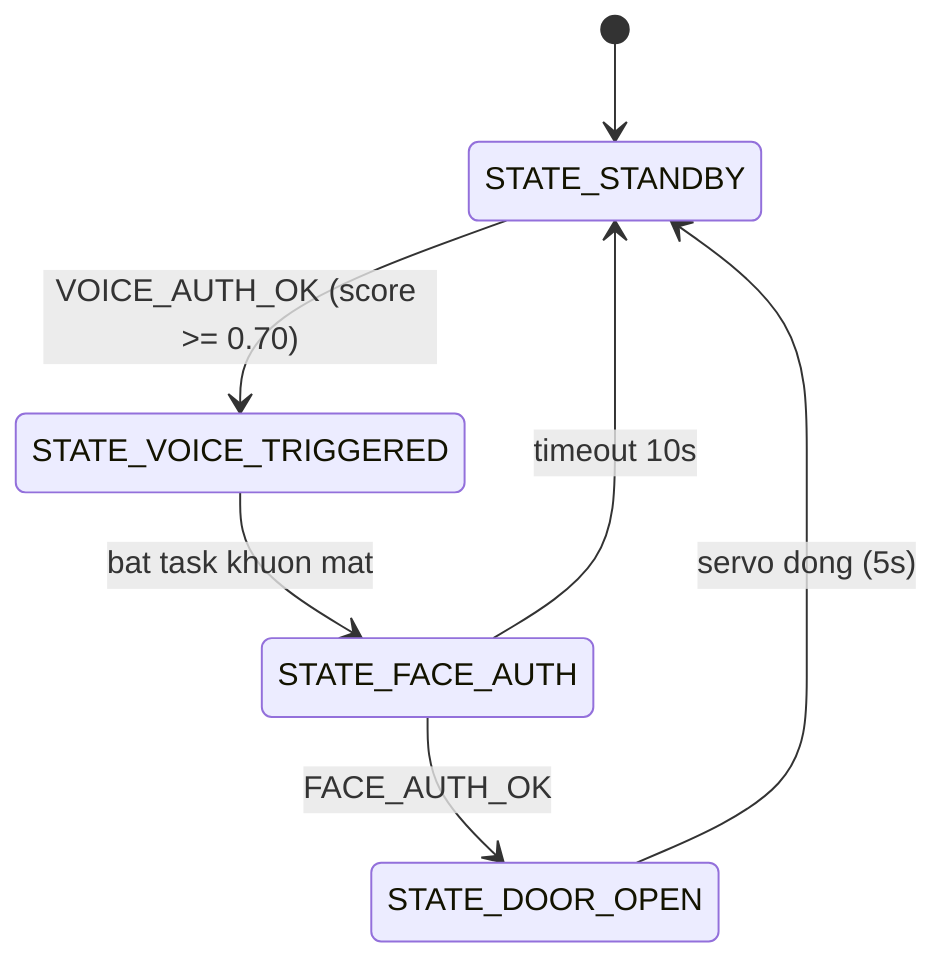

# BUỔI 5 — FREERTOS & MÁY TRẠNG THÁI (BỘ NÃO CỦA KHÓA CỬA)

> ⏱️ Thời lượng: ~3 giờ · 📊 Độ khó: ⭐⭐⭐ · 🎯 Mục tiêu: hiểu task/mutex/event group từ con số 0, tự viết máy trạng thái 4 trạng thái để ghép LED + Servo + Micro thành một hệ thống luân phiên làm việc.

---

## 5.0. Bản đồ buổi học

```
[5.1 FreeRTOS là gì] → [5.2 Máy trạng thái 4 trạng thái] → [5.3 Tự viết khung]
 → [5.4 Test với AI "giả"] → [5.5 Đối chiếu voice_auth_task thật]
```

## 5.1. FreeRTOS từ con số 0

FreeRTOS là **hệ điều hành thời gian thực**: cho chip chạy "nhiều việc cùng lúc" bằng cách chia nhau theo tick. Bốn khái niệm cần nắm:

| Khái niệm | Đời thường | Dùng ở đâu trong dự án |
|---|---|---|
| **Task** (xTaskCreate) | "công nhân" — mỗi task có vòng lặp riêng, có stack riêng | voice_auth_task, state_machine_task, face_recognition_task |
| **Mutex** (xSemaphoreCreateMutex) | "khoá phòng" — chỉ 1 người vào 1 lúc | bảo vệ camera (chỉ 1 task chụp), bảo vệ biến state |
| **Event Group** (xEventGroupCreate) | "bảng thông báo": set bit để báo người khác | voice task báo OK → state machine đọc bit |
| **Binary Semaphore** (xSemaphoreCreateBinary) | "tiếng gõ cửa": đánh thức 1 người đang ngủ | đánh thức face task đang ngủ (xSemaphoreTake portMAX_DELAY) |

**Vì sao cần nhiều cơ chế cùng lúc?** Task thu âm chạy liên tục nhưng task khuôn mặt chỉ bật khi cần; state machine là người "gác giữa" chờ cả hai; LED/Servo nằm ở 2 nơi khác. Event group chính là ngôn ngữ tín hiệu giữa chúng.


## 5.2. Máy trạng thái 4 trạng thái

Đây là "trái tim" của dự án — 4 trạng thái trong [`main/main.cpp`](../../main/main.cpp):

```cpp
typedef enum {
    STATE_STANDBY = 0,          // Chỉ nghe giọng. Camera OFF, LED tắt
    STATE_VOICE_TRIGGERED,      // Giọng đạt → camera ON, LED xanh cố định
    STATE_FACE_AUTH,            // Camera đang nhận diện mặt
    STATE_DOOR_OPEN             // Mặt đạt → servo mở, 5 giây, rồi đóng
} system_state_t;
```

Luồng chuyển tiếp:

1. Task thu âm đo được score ≥ 0.70 → set bit `VOICE_AUTH_OK_EVENT`.
2. `state_machine_task` chờ event (xEventGroupWaitBits), nhận được → chuyển sang STATE_VOICE_TRIGGERED, bật camera + đánh thức task mặt đang ngủ.
3. Task mặt nhận ra mặt khớp → set `FACE_AUTH_OK_EVENT` → state machine mở cửa 5 giây rồi về STANDBY.
4. Không có mặt trong 10 giây → timeout → về STANDBY.




## 5.3. Tự viết khung code của riêng bạn

Tạo file `main/door_state.cpp`: thấp nhất gồm biến toàn cục + hàm init + hàm task.

```cpp
#include "freertos/FreeRTOS.h"
#include "freertos/task.h"
#include "freertos/event_groups.h"

typedef enum { ST_STANDBY, ST_VOICE_OK, ST_FACE_AUTH, ST_DOOR_OPEN } my_state_t;

static my_state_t g_state = ST_STANDBY;
static SemaphoreHandle_t g_state_mutex = NULL;
static EventGroupHandle_t g_auth_events = NULL;

#define VOICE_OK_EVENT   (1 << 0)
#define VOICE_FAIL_EVENT (1 << 1)
#define FACE_OK_EVENT    (1 << 2)
#define FACE_FAIL_EVENT  (1 << 3)

void door_state_init(void)
{
    g_state_mutex = xSemaphoreCreateMutex();
    g_auth_events = xEventGroupCreate();
}
```

**Task máy trạng thái — BẠN điền phần "BẠN LÀM":**

```cpp
static void state_machine_task(void* arg)
{
    while (true) {
        EventBits_t bits = xEventGroupWaitBits(
            g_auth_events,
            VOICE_OK_EVENT | VOICE_FAIL_EVENT | FACE_OK_EVENT | FACE_FAIL_EVENT,
            pdTRUE,         // clear bits on exit: nhận rồi xoá, tránh "event ma"
            pdFALSE,        // chờ BẤT KỲ bit nào
            portMAX_DELAY   // chờ vô hạn, không timeout
        );

        if (bits & VOICE_OK_EVENT) {
            // BẠN LÀM 1: led_set_color(0, 255, 0)  (xanh cố định - đang chờ mặt)
            // BẠN LÀM 2: g_state = ST_VOICE_OK
            // BẠN LÀM 3: chờ kết quả mặt trong 10 giây:
            //   xEventGroupWaitBits(g_auth_events, FACE_OK_EVENT|FACE_FAIL_EVENT,
            //                       pdTRUE, pdFALSE, pdMS_TO_TICKS(10000))
            // BẠN LÀM 4: nếu FACE_OK: led_blink_green_success(); servo_open_door();
            //            vTaskDelay(pdMS_TO_TICKS(5000)); servo_close_door();
            // BẠN LÀM 5: nếu timeout/fail: ESP_LOGW cảnh báo
            // BẠN LÀM 6: luôn kết thúc về g_state = ST_STANDBY; led_off();
        } else if (bits & VOICE_FAIL_EVENT) {
            // BẠN LÀM: led_blink_red_fail(); led_off();
        }
    }
}
```

Đoạn tương ứng trong mã thật của dự án (đối chiếu sau khi tự viết):

```cpp
if (bits & VOICE_AUTH_OK_EVENT) {
    led_set_color(0, 255, 0);
    g_system_state = STATE_VOICE_TRIGGERED;
    g_face_recognition_active = true;      // cho phép task mặt chạy
    xSemaphoreGive(g_face_trigger_sem);    // đánh thức task mặt đang ngủ

    bits = xEventGroupWaitBits(g_auth_events,
        FACE_AUTH_OK_EVENT | FACE_AUTH_FAIL_EVENT,
        pdTRUE, pdFALSE, pdMS_TO_TICKS(10000));   // CHỜ 10 GIÂY

    g_face_recognition_active = false;      // tắt camera cho tiết kiệm
    g_system_state = STATE_FACE_AUTH;

    if (bits & FACE_AUTH_OK_EVENT) {
        led_blink_green_success();
        g_system_state = STATE_DOOR_OPEN;
        servo_open_door();
        vTaskDelay(pdMS_TO_TICKS(5000));    // cửa mở 5 giây
        servo_close_door();
    } else {
        ESP_LOGW(TAG, "FaceID timeout/fail → STANDBY");
    }

    led_off();
    g_system_state = STATE_STANDBY;
} else if (bits & VOICE_AUTH_FAIL_EVENT) {
    led_blink_red_fail();
    led_off();
}
```


## 5.4. Test với AI "giả" (mock) — không cần buổi 6, 7 vẫn chạy được

Để test máy trạng thái mà chưa có AI thật, viết voice task "mock" theo RMS:

```cpp
static void voice_auth_task_mock(void* arg)
{
    int16_t* buf = (int16_t*)heap_caps_malloc(
        VERIFY_TOTAL_SAMPLES * sizeof(int16_t), MALLOC_CAP_SPIRAM);

    while (true) {
        audio_capture_record(buf, VERIFY_TOTAL_SAMPLES);   // thu 3 giây (buổi 4)

        long sum = 0;
        for (int i = 0; i < VERIFY_TOTAL_SAMPLES; i++) sum += (long)buf[i] * buf[i];
        float rms = sqrtf((float)sum / VERIFY_TOTAL_SAMPLES);

        // FAKE: RMS to coi như "giọng ok" — thay AI thật của buổi 6-7
        float score = (rms > 300.0f) ? 0.9f : 0.2f;
        xEventGroupSetBits(g_auth_events,
                           score >= 0.70f ? VOICE_OK_EVENT : VOICE_FAIL_EVENT);
        vTaskDelay(pdMS_TO_TICKS(1000));
    }
}
```

Ghép vào app_main:

```cpp
extern "C" void app_main(void)
{
    led_init();  servo_init();
    audio_capture_init();
    door_state_init();

    xTaskCreate(voice_auth_task_mock, "voice", 4096, NULL, 5, NULL);
    xTaskCreate(state_machine_task,   "sm",    4096, NULL, 6, NULL);
}
```

Kết quả mong đợi trên log/LED:

- Nói to vào mic (RMS > 300) → 1 giây sau LED xanh cố định; cần một "FACE_OK mock" thì servo quay 90° rồi về 0° sau 5 giây.
- RMS 30–300 (tiếng nền) → LED đỏ nháy 3 lần (VoiceID FAIL) rồi tắt.
- RMS < 30 (im lặng) → không có gì xảy ra.


## 5.5. Đối chiếu đáp án mẫu — main.cpp của dự án

Mở [`main/main.cpp`](../../main/main.cpp) và tìm `door_state_task` (`Ctrl+F`). Bảng ứng viên của bạn giờ khớp với mã thật:

| Dự án | Khóa học | Khác nhau ở chỗ nào |
|---|---|---|
| `#define VOICE_OK_EVENT   (1 << 0)` | Giống | — |
| `xEventGroupCreate()` trong `door_state_init()` | Giống | Dự án đặt tên biến `g_auth_events` như bạn (`static`) |
| `door_state_task` chọn trạng thái theo bitmap | Giống | Dự án có thêm `STATE_MAINTENANCE` (web push dữ liệu server) — ta lược bỏ để học dễ hơn, quay lại buổi 10 |
| `vTaskDelay(pdMS_TO_TICKS(state_cache_ms))` | Giống | 3000 ms, nếu dùng nhanh hơn sửa thành 500 ms |
| `iis_event_group` | Giống | Tên biến dự án là `iis_event_group` (`iis` là lỗi chính tả của `i2s` ở nguồn tham khảo, giữ nguyên cho khớp code thật) |

Ba lỗi hay gặp khi ta tự viết lại:

- **Quên kiểm tra `xTaskCreate` trả về `pdPASS`** trên thiết bị thật RAM heap ít → task không được tạo, LED không nhấp nháy, tưởng code sai. Kiểm: `if (xTaskCreate(...) != pdPASS) { ESP_LOGE(TAG, "..."); }`.
- **Event group cho phép set bit từ ISR** — nếu muốn set bit từ ngắt (ví dụ: dữ liệu RX tới từ I2S DMA callback) phải dùng `xEventGroupSetBitsFromISR()`, không được gọi bản thường `xEventGroupSetBits()` từ ISR. Trong hệ này chỉ cần set từ task là đủ — nguyên tắc: **ISR thật sự ngắn, nạp nặng xuống task**.
- **Thứ tự khởi tạo quan trọng** — ta đã tạo event group trong `door_state_init()` (gọi trước `xTaskCreate`) nhằm tránh lỗi task đọc bit trước khi event group tồn tại — nếu không sẽ gặp lỗi Access Violation (tham chiếu con trỏ NULL).

